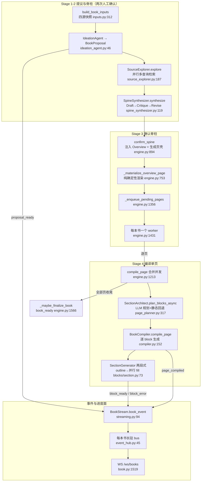
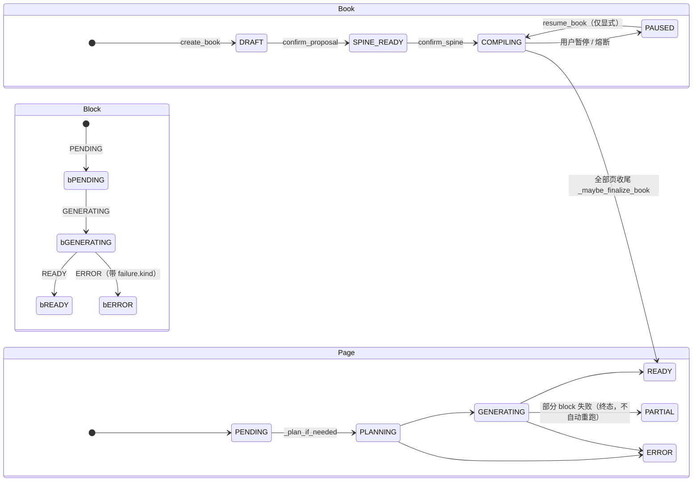

# 教材生成管线代码导读（guide-book-pipeline-2026-10）

- 基线：`origin/main @ 6cf793bd8`（v1.6.14）。
- 范围：`deeptutor/book` 全模块——inputs → engine 编排 → agents（ideation / source_explorer / spine_synthesizer / page_planner）→ blocks 渲染 → compiler → export 的阶段流转，以及 progress / event_hub / streaming 组成的进度与事件面。
- 去重：通用事件机制（StreamBus、KB 进度链）见 `docs/guides/events-and-progress-chain.md`，本文只讲书管线如何使用它们；出题/笔记本链路另有导读（当前不在 main 上，引用即可，此处不展开）；`tests/book/*` 测试面只作引用，不在本文解释。
- 行号锚均为该基线下的 `path:line`，相对仓库根目录。

## 0. 全景：一条两级确认 + 后台编译的流水线

BookEngine 与 ChatOrchestrator 平行（不是 TurnCapability），是 API/CLI/SDK 的唯一入口（`deeptutor/book/engine.py:5`-38）。用户在两个闸口签字（proposal、spine），签字之后编译完全后台化，靠每本书一条长生命周期事件流回报进度：



持久形态（`deeptutor/book/storage.py:7`-19）：每本书一个目录，`manifest.json`（Book）+ `spine.json` + `inputs.json` + `exploration.json` + `progress.json` + `log.md` + `pages/{page_id}.json`。所有写都是原子替换（`storage.py:54`-56），且读-改-写依赖单进程事件循环不被 await 打断这一不变量（`storage.py:98`-112 的 docstring 讲清了前提）。

## 1. 阶段与状态机

| 阶段 | 输入 → 输出 | 关键锚 |
| --- | --- | --- |
| Stage 0 输入快照 | 用户意图 + 聊天选择 + 笔记本 + KB + 错题 → `BookInputs` + `IdeationContext` | inputs.py:312（四源解析：聊天 :95、笔记本 :180、错题本 :229） |
| Stage 1 构思 | IdeationContext → `BookProposal`（DRAFT 落盘） | engine.py:467-550；ideation_agent.py:46（JSON 重试，`expected_key="title"` :76） |
| Stage 2 探索 + 脊柱 | Proposal + Inputs → `ExplorationReport` → `Spine` + `ConceptGraph`（SPINE_READY） | engine.py:560-701；source_explorer.py:187；spine_synthesizer.py:119 |
| Stage 2.5 概览注入 | Spine → 幂等插入 Overview 章 + 确定性渲染概览页 | engine.py:705（注入）、:753（渲染，无 LLM） |
| Stage 3 确认脊柱 | Spine → 页壳（PENDING）+ 入队 + COMPILING | engine.py:894-994 |
| Stage 3-4 编译单页 | Chapter+Page → 逐 block 填充 → READY/PARTIAL/ERROR | engine.py:1213/1280；compiler.py:152 |
| Stage 5 阅读进度 | 访问/书签/答题 → `Progress`（派生而非累加） | engine.py:2071/2095；progress.py:70/:110 |
| 出口 | Markdown 导出 | book.py:1269 → export.py:271 |

三个状态机（models.py:29/:42/:51）：



注意 `Page.PARTIAL` 被刻意排除在"未完成"集合之外（engine.py:109-120）：编译器已把每个 block 都跑过一遍，重新入队只会重烧同样的模型调用，`force` 重生成是唯一的回头路。

## 2. 模块责任表

| 模块 | 责任 | 不负责 | 关键锚 |
| --- | --- | --- | --- |
| `book/inputs.py` | 四源输入合并为 `BookInputs` 快照 + `IdeationContext` 提示块；各源失败降级为空段并告警 | 不做任何生成 | inputs.py:312（render :50） |
| `book/engine.py` | 全程编排：阶段推进、每本书 runtime（队列/worker/in-flight 表）、熔断、暂停恢复、block CRUD、进度写入 | 不直接调 LLM 生成正文 | engine.py:317（类）；:273（_BookRuntime） |
| `book/agents/ideation_agent.py` | Stage 1：IdeationContext → BookProposal | — | ideation_agent.py:46 |
| `book/agents/source_explorer.py` | Stage 2 prep：多查询并行检索（限流 6 并发 / 48 次上限）产出 `ExplorationReport`，后续阶段复用不再打 RAG | 不生成章节 | source_explorer.py:54-55（闸门）、:58（按源轮询切片）、:187（explore） |
| `book/agents/spine_synthesizer.py` | Stage 2 主力：Draft→Critique→Revise 产出章节树 + 概念图，附带拓扑排序/环消除/覆盖补齐 | — | spine_synthesizer.py:119（循环）、:305（物化+校验） |
| `book/agents/spine_agent.py` | **遗留单发版**，已被 SpineSynthesizer 取代，勿在新代码引用 | — | spine_agent.py:1-8 |
| `book/agents/page_planner.py` | Stage 3 规划：`SectionArchitect` LLM 规划 block 序列，失败回退按 ContentType 的静态模板；depth 缩放 target_words | 不写正文 | page_planner.py:73（模板）、:317（LLM 层）、:199（静态层）、:415（PagePlanner 遗留别名） |
| `book/blocks/*` | 各 BlockType 的生成器：无状态、`generate` 永不抛异常、失败记 `failure{kind,retryable}` 到 metadata | 不管页面状态聚合 | blocks/base.py:135（包装）、:38（失败分类）、:204（注册表）；两段式长文 blocks/section.py:73 |
| `book/compiler.py` | 单页编译：规划→逐块生成（限流/顺序）→桥接文本→每块落盘→页状态聚合（READY/PARTIAL/ERROR）与系统性失败判定 | 不管队列与书状态 | compiler.py:152、:265、:320（退避重试）、:350（bridge）、:454（聚合）、:70（systemic_failure_reason） |
| `book/storage.py` | 目录布局、原子 JSON 读写、追加式 log.md、id 合法性校验 | 不做缓存/锁（见 :98-112 不变量） | storage.py:151/:194/:311/:335/:367 |
| `book/event_hub.py` | 每本书一条进程级长驻 bus（400 条历史 + seq），只有删书才关闭 | 不负责 WS 连接管理 | event_hub.py:40/:45/:63 |
| `book/streaming.py` | BookStream：固定 `source="book_engine"` 的发射助手 + 阶段常量 + `book_event(kind)`（PROGRESS 通道 + metadata.kind） | — | streaming.py:21-30（阶段名）、:94（book_event） |
| `book/progress.py` | 阅读进度的纯函数层：按每题**最新**作答重算 score/weak_chapters（派生非累加） | 不落盘 | progress.py:38/:49/:54/:70 |
| `book/export.py` | 整本 Markdown 导出：每个 block 类型一个文本投影，纯视觉块降级为描述+指针，非 READY 块跳过 | 不改存储 | export.py:222/:271/:175 |
| `book/kb_health.py` | KB 指纹/文档指纹、漂移检测（stale_page_ids）、log 健康扫描 | 不自动重编译 | kb_health.py:104/:177/:326/:377 |
| `book/context.py` | 把书/页/块序列化成页聊天的上下文文本 | — | context.py:91 |
| `book/language.py` / `overview_copy.py` / `estimate.py` | 书语言判定（:81）、概览页文案（:80）、按 depth 估算章节规模（:30） | — | — |
| `book/errors.py` | `BookPausedError`（暂停书拒绝生成） | — | errors.py:4；HTTP 映射 book.py:58 |
| `api/routers/book.py` | REST + WS 入口；挂载于 deeptutor/api/main.py:644-645 | 不写业务编排 | 端点清单见 book.py:557-1346；WS :1519 |

## 3. 主链路逐段细读

### 3.1 Stage 1：create_book（engine.py:467）

`build_book_inputs`（inputs.py:312）先把四个来源物化成快照：聊天按 session 拉消息（:95，默认每会话 60 条、可选 message_ids 过滤）、笔记本经 `NotebookAnalysisAgent` 蒸馏（:180，失败回退为标题+摘要列表）、错题本按 category/entry 拉取（:229，每类 50 条上限）、外部资料经 learning 侧的 `build_topic_materials`/`ground_topic_sources` 拼进 `source_context`（:342-372，每段截 80k 字符）。任何一源失败只 warning 降级，不阻断建书。

`IdeationAgent`（ideation_agent.py:46）用 `json_with_reasoning_retry` 防"思考型模型只回思考不回 JSON"（:76，`expected_key="title"` 是判定真响应的锚）。`_coerce_proposal`（:84）把 estimated_chapters 夹在 2..8。落盘顺序：Book(DRAFT) → inputs → 初始 Progress → log（engine.py:533-538）；若选了 KB，立即抓指纹基线，否则首次健康检查会把全部 KB 误报为"新增"（:526-532）。发 `proposal_ready` 事件（:540）。

### 3.2 Stage 2：confirm_proposal（engine.py:560）

两个子阶段都包在 `bstream.stage(...)` 里（阶段名见 streaming.py:21-30）：

1. **SourceExplorer**（source_explorer.py:187）：一次 LLM 设计查询（:253）→ 查询 × KB 并行检索，`Semaphore(6)` 限流、总量 48 上限（:510-516）→ 按源轮询切片防止单一引擎的大分数垄断（:58-86）→ LLM 综合 summary/candidate_concepts。报告持久化（engine.py:603）并在 book.metadata 写入 `source_quality` 摘要（:604-607，缺失 KB、零证据块都会变成 warning，engine.py:171-216）。
2. **SpineSynthesizer**（spine_synthesizer.py:119）：Draft→Critique→Revise，默认 max_rounds=2；每轮经 `on_round` 回调把轻量摘要推成 `spine_round` 事件（engine.py:653-668，不推全量 payload）。`_call_json`（:256）收集完整流后解析，截断响应按空处理（:268-285），推理模型空转有降思考重试（:288-296，同 #1316）。物化（:305）做三道确定性校验：概念图去环、章节拓扑排序、覆盖补齐，再从原始图构建**章级思维导图**（:339-347）——用户看到的概览图与章一一对应，而非原始概念图。

成功后 book → SPINE_READY，spine 落盘，发 `spine_ready`（engine.py:679-700）。

### 3.3 Stage 3：confirm_spine（engine.py:894）

顺序固定：剪枝已删章节的概念图节点（:920，`_prune_concept_graph` :143）→ 幂等注入 Overview 章（:929；判定靠 `content_type` + `auto_overview` 双标记，:250-260，防编辑器乱序导致重复注入 :705-734）→ 按 chapter 建页壳，已存在的页同步标题/顺序/类型（:947-961，否则编辑脊柱对读者不可见）→ 确定性渲染概览页（:969）→ book → COMPILING，记录 `compile_started_at`（:983，所有观看者时钟一致）→ `auto_compile` 时入队（:992-993）。

概览页三块（intro 文本、概念图 mermaid、章节索引）全部确定性构建（engine.py:787-848），且重建时保留用户手改块与笔记（:850-872）——这是全书唯一"整体替换块"的地方，所以有专门的保护。

### 3.4 后台编译队列与 worker（engine.py:1354-1513）

`_BookRuntime`（:273-291）：`asyncio.Queue` + `queued` 集合 + **in-flight 表**。所有能编译页面的路径（读者打开、worker 轮到、强制重生成）都走 `compile_page`（:1213）合并：普通请求 join 已在跑的 run；`force` 请求等它跑完再开新一轮（:1250-1257）；`asyncio.shield` 保证单个调用者断开（如 WS 关闭）不会把别人依赖的编译一起取消（:1259-1266）。

worker 循环（:1431）：先清 scoped LLM 配置（:1443-1445，防止继承首个入队请求的临时模型选择）；2s 取不到任务且无 in-flight 则退休并触发内存回收（:1448-1459）；每个待编译页仍经由 `compile_page` 进入（:1475），与前台天然互斥。

### 3.5 Stage 4：单页编译（compiler.py:152）

`_plan_if_needed`（:402）在页面无块时触发：置 PLANNING、发 `page_planning`、`SectionArchitect.plan_blocks_async`（page_planner.py:317）产出 block 序列。LLM 层校验/裁剪到 12 块、只放行 PLANNABLE 类型、保证至少一个 SECTION（:393-404，否则章节会没有正文）；失败或空结果回退静态模板（:348-350）。`_build_block`（:166）是 depth 缩放 target_words 的唯一收口（:174-180）。

随后页面置 GENERATING（compiler.py:189），按 `block_concurrency` 顺序或并发生成（:220-236）。每个 block：发 `block_started` → 注册表查生成器（缺失即块级 ERROR，:288-291）→ `_generate_with_retry` 对 `retryable` 失败做一次指数退避重试（:320-346）→ READY 块附带桥接文本（:295-298，`transition_in` 提示 → 短段落，失败仅告警 :376-378）→ 每块落盘（:302-303，崩溃只丢未完成块）。最后 `_finalize_page_status`（:454）聚合：全 READY→READY；全失败→ERROR；否则 PARTIAL。发 `page_compiled`。

长文主体 `SectionGenerator`（blocks/section.py:73）是两段式：outline LLM 一次（:91-103，空 subsections 视为 GenerationFailure）→ 各小节并行 fill（:112-124），token 预算按 target_words 动态放宽（:37-48，防截断），outline 失败有确定性回退（:214-218）。证据统一来自 `BlockContext.relevant_chunks`（blocks/base.py:108）对 ExplorationReport 的本地过滤，不再打 RAG。

### 3.6 收尾、熔断与生命周期（engine.py:1515-1591）

- **熔断**：worker 只统计"系统性失败"——页内多数失败块属于 `rate_limit/provider_error/timeout`（compiler.py:50/:70-95）。连续 2 页如此即暂停整本书（engine.py:106、:1529-1534），置 PAUSED + `pause_kind=provider`，发 `compilation_paused`（:1536-1564）。未生成页保持 PENDING，等用户修好额度后 `resume_book` 原样接续。
- **暂停/恢复**：`pause_book`（:1030）先落 manifest 再取消任务，进程中途被杀也不会自动续跑；`resume_book`（:1076）把搁浅在 PLANNING/GENERATING 的页复位 PENDING 后重新入队；`maybe_resume_on_open`（:1132，入口 book.py:753）在读者打开 COMPILING 书时捡起死掉的 worker——刻意跳过 PAUSED（那是要用户先解决的）与 `lazy_compile`（那是读者自己选的按需编译）。
- **收尾**：`_maybe_finalize_book`（:1566）发现没有任何"未完成"页（READY 与 PARTIAL 都算收尾）即置 READY 并补发 `book_ready`（:1587-1591，没有这一步读者永远不知道书写完了）。
- **重建**：`rebuild_book`（:1172）保留 proposal/spine，删全部页后重走 confirm_spine；`_reset_page_for_force_compile`（:434）重置生成内容但保住 USER_NOTE 与 `edited_by_user` 标记的块。

### 3.7 事件与进度面

事件只有一条通路：engine/compiler → `BookStream.book_event(kind)`（streaming.py:94，走 PROGRESS 通道，`metadata.kind` 区分）→ 每本书的长驻 bus（event_hub.py:45）→ WS `/ws/books`（book.py:1519）按 `after_seq` 补发（:1495-1505、:1615、:1630）。book 事件 kind 全集（生产端锚）：`proposal_ready`（engine.py:540）、`exploration_ready`/`exploration_failed`（:614/:644）、`spine_round`（:666）、`spine_ready`（:690）、`overview_ready`（:879）、`compilation_paused`（:1069 用户/:1560 熔断）、`page_planning`/`page_planned`（compiler.py:417/:442）、`page_compile_started`/`page_compiled`（:165/:248）、`block_started`/`block_ready`/`block_error`（:277/:305）、`book_ready`（engine.py:1587）。

关键设计：**REST 与 WS 动作都发布进同一本 bus**（event_hub.py:27-28 的 docstring），所以"哪个入口触发的编译"对订阅者不可见也不重要；请求里的 `stream` 参数只是可覆盖项，后台路径一律用 `get_book_bus`。通用 StreamBus 的重放/序号机制见 events-and-progress-chain.md 第 5 节，此处不重复。

阅读进度（Progress）与编译进度是两回事：前者是纯函数层派生值（progress.py:19-27 的 docstring 解释了为什么按每题最新作答重算而非累加），写入点只有 quiz-attempt / visit / bookmark 三个端点（book.py:1102/:1250/:1260）；后者是编译事件流。管理面板用的生成诊断在 `generation_overview`/`generation_summary`（engine.py:1720/:1740）：`working`（本进程确实有 worker/in-flight，:1699）与 `interrupted`（说 COMPILING 但没人干活）把"在编"和"卡死"分开。

### 3.8 导出

`GET /books/{id}/export`（book.py:1269）→ `render_book_markdown`（export.py:271）：按页序拼接，只导 READY 块（:224-225），每个 block 类型一个文本投影（:222-268），FIGURE/INTERACTIVE/ANIMATION 降级为描述+代码/链接（:175-197），标签文案随书语言（:30-57）。

## 4. 失败路径清单

| # | 场景 | 现行为（设计取向） | 锚 |
| --- | --- | --- | --- |
| 1 | 输入源（聊天/笔记本/错题）解析失败 | warning 降级为空段，建书继续 | inputs.py:107-109/:195-197/:254-256 |
| 2 | SourceExplorer 整体失败 | 非致命：metadata 记 `exploration_failed` + 原因，脊柱仅凭 proposal 生成，发 `exploration_failed` | engine.py:625-648 |
| 3 | SpineSynthesizer LLM 调用失败/截断 | 返回空 dict，用上一个有效草稿；全空则物化最小单章书，管线不阻塞 | spine_synthesizer.py:297-299、:317-329 |
| 4 | 规划 LLM 失败 / 返回空 blocks / 全隐藏 token | `llm_json` 降思考重试一次（#1316）；仍失败回退静态模板 | page_planner.py:331-350；blocks/_llm_writer.py:137 |
| 5 | Section outline 失败或无 subsections | outline 阶段 `_fallback_outline`；fill 前空 outline 直接 GenerationFailure | blocks/section.py:214-218、:102-103 |
| 6 | 单个 block 生成失败 | 生成器**永不抛异常**：失败分类写入 `metadata.failure{kind,retryable}`，块置 ERROR，其余块继续 | blocks/base.py:38-85、:135-169 |
| 7 | retryable 块失败（429/超时/JSON 坏） | 编译器指数退避重试一次（默认 1 次额外尝试，2s 起倍增） | compiler.py:121-129、:320-346 |
| 8 | 桥接文本生成失败 | 非致命：只告警，块照常 READY | compiler.py:376-378 |
| 9 | 整页失败且多为系统性 provider 错误 | 熔断：连续 2 页即 PAUSED（pause_kind=provider），排空队列，保留已生成内容 | engine.py:106/:1517-1534/:1536-1564；compiler.py:70-95 |
| 10 | 编译中途异常把页面留在 PLANNING/GENERATING | `_mark_page_error` 兜底置 ERROR（否则既不会被 resume 也不能在 UI 强重生） | engine.py:1387-1407、:1334-1336 |
| 11 | PAUSED 书又被请求生成 | `BookPausedError`；worker 捕获后把在途页复位 PENDING 并退出 | engine.py:348-356、:1479-1489；errors.py:4 |
| 12 | 进程重启：manifest 仍是 COMPILING 但无 runtime | `status==COMPILING ≠ 在编`；`is_worker_live`/`interrupted` 区分；读者打开书时 `maybe_resume_on_open` 捡起（PAUSED/lazy_compile 除外） | engine.py:1699-1718、:1720-1738、:1132-1170；book.py:753 |
| 13 | 同页并发编译（打开页 + worker + force） | in-flight 表合并：普通 join，force 等待后重跑；shield 防单调用者取消共享 run | engine.py:1213-1266 |
| 14 | worker 池孤儿（队列有货但 worker 已亡） | 入队双锁重校验 runtime（:1356-1364）；打开书时按"活性"而非队列深度判断 | engine.py:1356-1377、:1153-1162 |
| 15 | PARTIAL 页被反复入队 | 设计上排除：PARTIAL 是终态，force regenerate 是唯一回去的路 | engine.py:109-120、:1295 |
| 16 | 概览页被通用编译器覆盖 | 编译入口直接短路：概览页永远确定性重建，不进 LLM | engine.py:1304-1310 |
| 17 | emit 到已删除书的 bus | StreamBus 关闭后 emit 静默 no-op；bus 只在 delete_book 关闭 | deeptutor/runtime/stream_bus.py:63-64；event_hub.py:63-71；engine.py:397-408 |
| 18 | KB 在编译后发生漂移 | 指纹/文档指纹对比 → `stale_page_ids` + 漂移报告，不自动重编 | kb_health.py:177/:326/:377；engine.py:1671 |
| 19 | 非法 book/page id（路径穿越面） | `_safe_book_id` 拒绝而非清洗 | storage.py:62-79 |
| 20 | quiz submission_id 重放 | 幂等：同答案直接返回；不同答案报错 | progress.py:82-94 |
| 21 | 深潜子页混入顶层脊柱 | `deep_dive` 标记的合成章被脊柱编辑器隐藏，rebuild 不复活 | engine.py:2012-2018 |

## 5. 三处最易误读点

1. **事件流不是请求级的。** 编译事件发到 `get_book_bus(book_id)` 这条每本书长驻的 bus（event_hub.py:45），不是调用者传入的 StreamBus；请求级 bus 在 router finally 关闭后 `emit` 会静默丢弃（stream_bus.py:63-64）。因此判断"事件会不会丢"永远看 book bus 的生命周期（删书才关，event_hub.py:63），`engine` 各方法里的 `stream` 参数只是可覆盖项。
2. **PARTIAL 是终态，不是待办。** `_UNFINISHED_PAGE_STATUSES` 故意不含 PARTIAL（engine.py:109-120）：resume/重开书都不会重跑部分成功的页，`_maybe_finalize_book` 也把"无未完成页"当作书写完了（:1573）。想要重跑只有 force regenerate（:434 会保住用户手改与笔记）。看到"书 READY 但某页缺块"不是 bug，是防重复烧钱的设计。
3. **`book.status == COMPILING` 不等于正在编译。** manifest 是持久事实，重启后仍然写着 COMPILING；唯一诚实的答案是进程内 runtime 表（`is_worker_live`，engine.py:1699-1718）。诊断类问题先看 `generation_overview` 的 `working`/`interrupted`（:1720-1738），跨进程恢复入口是"打开书"这一动作（book.py:753），不是启动时全量扫描——PathService 按当前用户解析路径，启动扫描根本枚举不到别人的书（engine.py:1135-1143 的 docstring）。

## 6. 建议阅读顺序与验证命令

顺序：models.py（状态机与数据形状）→ inputs.py → engine.py:467-550（Stage 1）→ source_explorer.py + spine_synthesizer.py（Stage 2）→ engine.py:894-994（Stage 3）→ page_planner.py → compiler.py → blocks/base.py + blocks/section.py → engine.py:1354-1591（队列/熔断/收尾）→ event_hub.py + streaming.py → progress.py → export.py；按需读 kb_health.py / context.py / api/routers/book.py。通用事件底座先读 `docs/guides/events-and-progress-chain.md`。

复核锚点（在仓库根执行）：

```bash
git rev-parse origin/main          # 期望 6cf793bd8...
grep -n "CONSECUTIVE_PAGE_FAILURE_LIMIT\|_UNFINISHED_PAGE_STATUSES" deeptutor/book/engine.py
grep -n "def compile_page\|def _plan_if_needed\|def _finalize_page_status" deeptutor/book/compiler.py
grep -n "def get_book_bus\|BOOK_EVENT_HISTORY_LIMIT" deeptutor/book/event_hub.py
grep -n "def book_event" deeptutor/book/streaming.py
grep -rn "book_event(" deeptutor/book/engine.py | head   # 事件 kind 全集的生成端
```

相关测试面（仅引用）：`tests/book/`（阶段流转 `test_engine_stage_transitions.py`、调度 `test_compile_scheduling.py`、概览章 `test_overview_chapter.py`、编辑 `test_editing.py`、进度 `test_progress.py`、worker 上下文 `test_worker_context.py` 等）。
