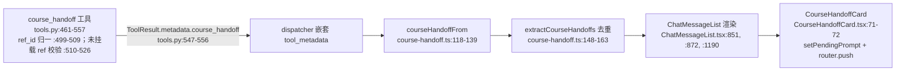

# 课程域代码导读（courses 路由/状态/删除）

- 基线：`origin/main @ 6cf793bd8`（v1.6.14），#1754（课程删除失败上表面修复）已随 `46199adf5` 合入。所有 `path:line` 均在该基线逐一核对；本文为纯导读，不改产品代码。
- 范围：courses 路由与状态管理、课程删除链路（含 #1754）、与工作区/学习记录的关联。
- 边界声明（去重）：
  - 学习引擎域（判分/调度/事件/存储）→ guide-learning-domain（`myfork/guide/learning-domain-20261007` 分支 `docs/guides/learning-domain.md`）。课程是**容器层**：只存引用与约定，不拥有任何学习数据。
  - courses_state 聚合器测试产物 → test-courses-state（`myfork/test/courses-state-20261005` 分支，`e7c0b0f68` 新增 `tests/services/test_courses_state.py` 444 行，**尚未合入 main**）。
  - 全局事件/进度链路 → `docs/guides/events-and-progress-chain.md`（已在 main）。

## 0. 模块地图

课程域分五层，前后端共用同一个状态聚合作为唯一真相源：

| 层 | 文件 | 职责 |
| --- | --- | --- |
| 存储 | `deeptutor/services/courses.py`（600 行） | `CourseService`（:250）读写 `<workspace>/courses/courses.json`；数据类 `StudyCourse`（:132）、`CourseResource`（:108）、`SyllabusUnit`（:83） |
| 聚合 | `deeptutor/services/courses_state.py`（421 行） | `build_course_state`（:343）跨六个子系统做 best-effort 全景快照；`resolve_resource_reference`（:184）单引用解析 |
| 路由 | `deeptutor/api/routers/courses.py`（213 行） | CRUD/教学大纲/资源挂载/状态/删除；挂载于 `deeptutor/api/main.py:673`（`/api/courses` + auth） |
| 能力 | `deeptutor/capabilities/course_study/` | `mode.py:54` `CourseStudyCapability`（薄壳进 chat loop）；`capability.py:380` `CourseStudyLoopCapability`（状态感知+移交策略）；`tools.py` 四个工具（:21-26）；提示词 `prompts/{en,zh}/course_study.yaml`；注册 `deeptutor/runtime/bootstrap/builtin_capabilities.py:45`、`:219-222` |
| 前端 | `web/app/(utility)/courses/`、`web/components/courses/`、`web/lib/courses-api.ts`（345 行）、`web/lib/course-handoff.ts`（226 行） | 列表页 `page.tsx:12-14` → `CoursesShelf`；详情页 `[courseId]/page.tsx`（435 行）；API 客户端 + 移交卡解析 |

资源引用是"引用集不是所有权"：七种 `COURSE_RESOURCE_KINDS`（`courses.py:44-52`；前端镜像 `courses-api.ts:12-20`）各归原系统所有，detach/删除课程绝不销毁目标本体（`courses.py:8-13` 模块 docstring）。唯一例外是会话：会话经 `preferences.course_id` 反向指向课程（`courses.py:15-17`），因为会话由课程产生且只属于一门。

## 1. 存储模型（courses.json）

- 单文件索引 `<workspace>/courses/courses.json`：`CourseService.__init__`（`courses.py:253-255`），每次 `get_course_service()`（:580-581）新建实例，锁按文件路径共享（`_lock_for` :236-247），写入走 `atomic_write_json`（:319-320）。
- 读入宽松降级：`_load`（:275-317）逐行清洗，越界截断（名称 60/描述 300/instructions 与 agent_notes 各 4000，:61-64）；旧六字段课程照常加载（兼容测试 `tests/api/test_courses_router.py:425`）。
- 教学大纲整体替换而非逐条 CRUD：`set_syllabus`（:507-528），保留 unit id 即保留 covered 状态（router 侧 `courses.py:129-139`；测试 `test_courses_router.py:294`）。`covered` 永远是学习者手填，不从掌握度推断（`courses.py:91-96`）。
- `agent_notes` 追加式、溢出从**头部**裁剪（`append_agent_note` :475-505），最旧先过期。
- 状态只有 active/archived：`set_status`（:547-568），归档可逆且不碰引用（:550-553）。

## 2. 数据流

### 2.1 会话绑定链路（?course= → turn metadata）

```mermaid
flowchart LR
    A["/courses 详情页<br/>Start course study / New course chat<br/>[courseId]/page.tsx:250-256, :269-282"] -->|"/chat?course=<id>"| B["ChatWorkspace 读取 query<br/>ChatWorkspace.tsx:1317"]
    B --> C["state.courseId<br/>ChatWorkspace.tsx:341-346<br/>课程缺省能力/人设一次性预填 :1337-1357"]
    C --> D["StartTurnInput.courseId<br/>start-turn.ts:52"]
    D --> E["course_id 字段<br/>buildStartTurnInput.ts:112"]
    E --> F["WS turn 请求<br/>turn_request.py:178（运行时选项映射 :19）"]
    F --> G["request_preparer 校验绑定<br/>request_preparer.py:295-318<br/>CourseNotFoundError → 清空为无课程"]
    G --> H["_apply_course_defaults<br/>_turn_runtime_shared.py:732-761<br/>补 KB/人设/能力缺省，显式值优先"]
    H --> I["executor 写入 metadata<br/>executor.py:957-958<br/>course_id + course_conventions"]
    I --> J["capability.is_active 双信号<br/>capability.py:386-387<br/>mode==course_study 且 course_id 非空"]
```

- 服务端校验在 `request_preparer.py:300-312`：课程 id 必须能被 `CourseService.get` 解析，否则静默降级为普通会话——course 工具不会泄漏进普通 chat（`capability.py:9-12` 设计约束）。
- 课程约定进系统提示走两条路：全量 conventions 块 `_course_conventions_block`（`_turn_runtime_shared.py:775` 起，上限 1200 字符 ：767，只含学习者 instructions 不含 agent_notes），与 pre_loop 有界摘要里的裁剪版（`capability.py:198-214`，instructions 900 / notes 500）。
- `?course=` 还会让独立学习面（mastery/reading/notebook/practice）挂上课程范围：`web/lib/course-session-scope.ts:3-11`、`web/components/courses/CourseScope.tsx:50`（`useCourseScope`，创建的资源自动 attach 回课程，:24-31 注释）。

### 2.2 课程状态聚合（build_course_state）

`build_course_state`（`courses_state.py:343-421`）是课程页与 course_study 工具共用的唯一真相源（`courses-api.ts:78-84` 注释）：

1. 取课程本体（:347，`asyncio.to_thread`）。
2. 并发拉六个子系统的资源索引 + 会话统计（:348-351）。每个 loader 独立降级：`_safe_index`（:34-42）失败只 warning 返回空表——一个子系统不可用不拖垮整页（前端兜底 `[courseId]/page.tsx:70-73` 直接 `.catch(() => null)`）。
3. loader 表 `_INDEX_LOADERS`（:205-212）：knowledge_base(:45)/book(:53)/notebook(:71)/mastery_path(:115)/reading_workspace(:141)/partner(:167)；`partner_group` 无注册表，刻意保持空表让旧引用可预期降级（:221-223）。
4. 会话统计 `_session_state`（:226-258）：按 `preferences.course_id` 过滤、按更新时间排序、archived 计数、recent 5 条。
5. 题库统计 `_question_bank_state`（:261-307）：对该课程全部会话查 SQLite notebook 条目，wrong 全量 500/页翻页（:277-295），错题分类计数得出 weak_categories。
6. 组装（:355-411）：资源带 `available` 与 detail；syllabus 每单元附 `wrong_questions`（topics↔分类名双向子串匹配 ：377-392）；`next` = 第一个未覆盖单元（:394-405）。

同一聚合服务两个消费者：REST `GET /api/courses/{id}/state`（`courses.py:189-194`）与 capability 的 `course_overview`（`tools.py:268-275`）/pre_loop（`capability.py:483-522`，摘要限 3200 字符 :42、:372-377）。

### 2.3 移交链路（course_handoff → 前端卡片）

- 目标是闭集五项 `COURSE_HANDOFF_TARGETS`（`tools.py:67-73`，前端镜像 `course-handoff.ts:33-39`），服务端与前端双重拒绝未知值（`tools.py:471-475`；`course-handoff.ts:102-107`）——防开放重定向。
- ref 归一（`tools.py:491-509`）：模型拿 resource_id 也能路由（前端 URL 需要 ref_id）；非本课程资源只要目标子系统存在就放行（:510-526），解析失败时明说并回退索引页（:531-537）。
- 路由表 `courseHandoffHref`（`course-handoff.ts:172-195`）每个分支都带 `?course=` 保持课程范围；`targetAcceptsPrompt`（:94-100）规定只有带 composer 的目的地才预填开场白（`pending-prompt.ts:30` `setPendingPrompt`）。
- 回合策略补丁：handoff 同轮的散文即答案（`capability.py:422-465` + `final_text_override` :467-477），否则建议文本被折叠进 trace、turn 以空回复收场。
- 模型把 JSON 参数当正文复读时由 `stripLeakedHandoffJson` 去重（`course-handoff.ts:210-225`）。

## 3. 课程删除链路（含 #1754 修复）

### 3.1 前端（[courseId]/page.tsx）

- 入口：详情页菜单"Delete course"（:306-316），打开 `ConfirmDialog`（:414-432），重开时先清旧错误（:310）。
- **#1754 修复核心 `confirmDelete`（:181-197，合入提交 `46199adf5`，2026-10-07）**：
  - 修复前：handler 以 `void deleteCourse(...)` 触发、无 await 无 catch——删除失败产生 unhandled rejection、学习者无任何反馈、且仍然跳离课程页。
  - 修复后：`await` + try/catch；失败时留在当前页、`deleteError` 以 `role="alert"` 显示在对话框内（:427-431）且对话框保持打开可重试；只有成功才 `router.push("/courses")`（:187）；`deleteBusy` 在请求期间禁用确认按钮并显示"Deleting…"（:419-420）。
  - 回归测试：`web/tests/course-detail-delete.spec.tsx:68`（失败→alert+不跳转+对话框仍在）、`:87`（成功→先 deleteCourse(course id) 再 push("/courses")、无 alert）。
- API 客户端 `deleteCourse`（`courses-api.ts:235-241`）：DELETE 后 `invalidateClientCache("courses:")` 失效列表/状态缓存；HTTP 非 2xx 抛 `ApiError`（:131-150），detail 文案即前端 alert 内容。

### 3.2 后端（DELETE /api/courses/{course_id}）

`courses.py:197-213`，三步：

1. 先 `service.get(course_id)`，不存在→404（:200-203）。
2. **会话去分类化**：`list_all_sessions_snapshot`（`organization.py:8`）全量快照，逐个把 `preferences.course_id == 该课程` 的会话改为 `""`（:205-211）——即"会话不移入 Unclassified 不删除"承诺（前端文案 `[courseId]/page.tsx:424-426`）。
3. `service.delete`（`courses.py:570-577`）：持锁过滤后重写 courses.json；课程已不在则抛 `CourseNotFoundError`。

非破坏性不变量：资源引用（detach `courses.py:457-473`）与 KB/书/路径等本体一律不动；会话本体也不删，只丢课程标记。与归档的差异：删除不可逆（courses.json 里行没了），归档只是 `status` 翻转（:547-568）。

### 3.3 删除的涟漪

- 会话组织 PATCH 的级联（`sessions.py:565-576`）只随会话变更走，课程删除不级联 workspace_id/parent 链。
- workspace 依赖图把 `course_id` 引用记为 "courses" 特性（`workspace/dependencies.py:91`、`:163-164`），并扫描 `workspace/courses/*.json`（:236）——删除课程后残留引用会随快照消失，无孤儿清理步骤。
- 练习域按课程过滤用会话间接解析（`question_notebook.py:324-330` `_course_session_ids`），课程删除后题库自然回到全局视角，无需迁移。
- 侧边栏课程分组（`sidebar-entries.ts:29`、`:56`）由列表接口驱动，删除后下次拉取即消失（前端 15s TTL 缓存 `courses-api.ts:186`）。

## 4. 与工作区/学习记录的关联

| 关联 | 机制 | 锚点 |
| --- | --- | --- |
| 工作区 | courses.json 存于当前用户 workspace；`get_workspace_dir()/courses` | `courses.py:253-255` |
| 会话归属 | `preferences.course_id`；PATCH /api/sessions 组织接口校验课程存在并级联 selection_tutor 子线程 | `sessions.py:58`、`:532-541`、`:565-576` |
| 学习记录聚合 | 课程页数字 = 会话计数+题库错题+掌握目标数+阅读工作台，全部现算不落库 | `courses_state.py:226-307` |
| 掌握路径 | mastery_path 引用 → `LearningService().list_path_overviews`，目标口径非模块口径 | `courses_state.py:115-138`（注释 ：124-127） |
| 阅读 | reading_workspace 引用 → 阅读目录分页枚举（500/页） | `courses_state.py:141-164` |
| 练习/题库 | course → 会话集合 → notebook entries；practice 导入可带 course_id | `courses_state.py:261-307`；`practice/storage.py:326`、`:341` |
| 回合上下文 | 会话绑定课程后每回合注入 conventions + 状态摘要 | §2.1 |

## 5. 测试现状与空白清单

已有覆盖（基线 6cf793bd8）：

| 文件 | 行数 | 用例 | 要点 |
| --- | --- | --- | --- |
| `tests/services/test_courses.py` | 59 | 2（:15、:50） | 读写回环+原子落盘；大小写不敏感重名 |
| `tests/api/test_courses_router.py` | 455 | 15（:84-:425） | 挂载/幂等 attach/400/404/全子系统失败降级(:151)/字面路由顺序(:187)/缺省值(:200)/归档(:220)/非法状态(:253)/大纲×4/旧版 JSON(:425) |
| `tests/capabilities/test_course_study.py` | 1187 | 30 | 双信号门(:262)/no_course 提示(:277,:331)/摘要边界(:375,:905-931)/四工具转发与拒绝(:486-:1124)/handoff 双 id(:781)/unresolved ref(:1023-:1089)/散文即答案(:1126-:1168) |
| `tests/capabilities/test_course_study_dispatch.py` | 178 | 2（:86、:143） | handoff 经 dispatch 到达浏览器嵌套层；无课程拒绝 |
| `web/tests/course-detail-delete.spec.tsx` | 101 | 2（:68、:87） | #1754 回归：失败可见+不跳转；成功才跳转 |
| `web/tests/course-handoff.test.ts` | 239 | 15 | tool_metadata 嵌套/闭集拒绝/去重/各目的地路由/预填规则/复读剥离 |
| `web/tests/course-organization-api.test.ts` | 131 | 4 | 组织 patch 仅发送所改字段；策略失败保真；循环 parent 可渲染 |
| `web/tests/courses-shelf.spec.tsx` | 35 | 1（:24） | 仅授权失败可见 |

空白与可拆卡条目：

1. 【零测试·建议拆卡】`DELETE /api/courses/{course_id}` 端点（`courses.py:197-213`）：404 分支、"会话去分类"循环、与 `service.delete` 的组合行为均无 router 级测试（现有 404 测试 `test_courses_router.py:137` 只覆盖 attach/detach/state）。
2. 【零测试·同卡可并】`CourseService.delete`（`courses.py:570-577`）与 `detach_resource` 的 service 级删除语义（重编号 ：469-470）只在回环测试中被顺带使用（`test_courses.py:44`）。
3. 【待合并·建议拆卡】`tests/services/test_courses_state.py`（444 行，聚合器降级/持久化边界）已存在于 `myfork/test/courses-state-20261005`（`e7c0b0f68`），main 上没有——复核后合入，替代在本卡重写。
4. 【弱测试】`_question_bank_state` 500/页翻页路径（`courses_state.py:277-295`）无覆盖；`test_state_reports_syllabus_progress`（:347）只走小数据。
5. 【弱测试】courses-shelf 仅 1 用例：新建（`CoursesShelf.tsx:106-118`）、归档分组（:69-80）、空态、卡片导航未测。
6. 【弱测试】删除对话框重开清空 `deleteError`（`[courseId]/page.tsx:310`）无断言。
7. 【观察】`append_agent_note` 头部裁剪（`courses.py:496-501`）无 service 级单测，仅 capability 转发测试间接触达（`test_course_study.py:546`）。

陷阱备注：courses 路由里字面路由必须声明在所有 `/{course_id}` 路由之前，否则 `resource-candidates` 会被当成课程 id（`courses.py:88-93` 注释；回归测试 ：187）。
