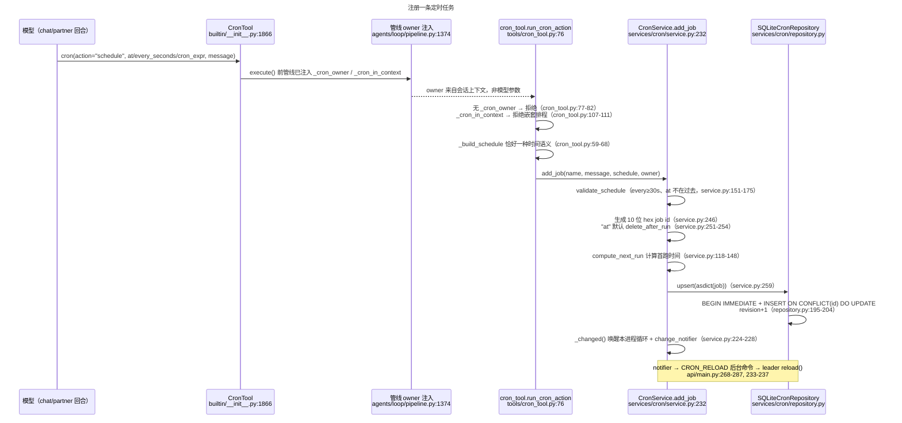

# 定时任务面代码导读（guide-cron-scheduling）

- 基线：`origin/main @ 6cf793bd8`（v1.6.14）。
- 范围：`deeptutor/services/cron/`（repository 持久化 / service 调度 / executor 执行）、`deeptutor/tools/cron_tool.py` 触发面，以及挂载、owner 注入与后台 leader 生命周期接线。
- 行号锚均为该基线下的 `path:line`，相对仓库根目录。注册点清点与逐条用例分析不在本文展开，行为断言以 `tests/services/cron/` 为准。

## 0. 全景：三个角色一把锁

定时任务面由四个文件构成，职责严格分层：

| 角色 | 文件 | 职责 |
| --- | --- | --- |
| 持久层 | `deeptutor/services/cron/repository.py` | WAL SQLite 任务存储；跨进程写串行；旧 `jobs.json` 一次性迁移 |
| 调度层 | `deeptutor/services/cron/service.py` | 任务 CRUD、到期拾取、leader 内的单进程调度循环 |
| 执行层 | `deeptutor/services/cron/executor.py` | 把到期任务投递为一次 chat 回合或 partner 回合 |
| 触发面 | `deeptutor/tools/cron_tool.py` + `CronTool`（`deeptutor/tools/builtin/__init__.py:1866`） | 模型可见的 schedule/list/cancel 动作；owner 由管线注入，模型不可指定 |

全局单例在 `get_cron_service()`（`deeptutor/services/cron/service.py:406`）：store 固定在管理 workspace 的 `cron/jobs.sqlite3`，legacy 文件为 `cron/jobs.json`，执行回调为 `execute_job`。服务由 API 生命周期启动/停止（`deeptutor/api/main.py:195-203`），但只有后台 leader 真正运行调度循环——`BackgroundLeaderSupervisor` 把 `_start_cron` 挂在 start_callbacks 里（`deeptutor/api/main.py:289-309`），其余 worker 只做 CRUD。

## 1. 任务注册：从模型调用到落库

要点：

- **owner 路由永远服务端决定**：partner 回合按 `channel_metadata` 组 owner（`deeptutor/agents/loop/pipeline.py:1382-1392`），chat 回合取当前用户（`pipeline.py:1393-1403`）。工具入口第一件事就是校验 `_cron_owner` 存在，否则返回 "Scheduling is not available in this context."（`deeptutor/tools/cron_tool.py:77-82`）。
- **动作别名**：`add`/`remove` 归一化为 `schedule`/`cancel`（`cron_tool.py:85-89`）。
- **list/cancel 天然按 owner 隔离**：`list_jobs(owner_key=...)`（`cron_tool.py:91-96` → `service.py:263-268`），`cancel_job` 带 `owner_key` 双重校验（`cron_tool.py:98-104` → `service.py:274-286`，SQL 层再校验一次 `repository.py:206-226`）。
- **注册即唤醒**：写入后 `_changed()` 设置 `_wake` 事件并触发 `change_notifier`；notifier 提交 `CRON_RELOAD` 后台命令（`deeptutor/api/main.py:275-285`），leader 收到后 `reload()` 强制刷新快照并重算睡眠时长（`api/main.py:233-237`、`service.py:219-222`）。即使通知链路失效，调度循环最长 60 秒兜底自醒（`service.py:29-31`、`service.py:346-355`）。

## 2. 到期执行：leader 的拾取与投递

```mermaid
---
title: 到期拾取与投递（仅 leader 进程）
---
sequenceDiagram
    participant L as CronService._loop<br/>services/cron/service.py:331
    participant T as _tick<br/>service.py:357
    participant J as _run_job<br/>service.py:367
    participant E as execute_job<br/>services/cron/executor.py:16
    participant C as chat 会话存储
    participant P as partner 总线
    participant R as SQLiteCronRepository

    loop 调度循环
        L->>T: 到点（wake 事件或 sleep 超时）
        T->>R: _load() 校验 revision，变了才重读（service.py:208-217）
        T->>T: 遍历快照 list(jobs)：enabled 且 next_run≤now（service.py:360-365）
        T->>J: 逐个 await _run_job（串行，不并发）
        J->>E: on_job(job) → (status, error)
        alt owner.kind == "partner"
            E->>E: partner 未运行 → skipped（executor.py:83-84）
            E->>P: InboundMessage(_cron_job_id 入 metadata)<br/>executor.py:86-95
            P-->>E: 回复沿原 IM 通道发布（executor.py:107-118）
        else owner.kind == "chat"
            E->>C: 会话不存在 → error（executor.py:146-148）
            E->>E: 以 owner scope 跑一轮 chat，turn_id=cron-&#123;job&#125;-&#123;rand&#125;<br/>executor.py:151-166
            E->>C: 追加 user+assistant 消息（executor.py:180-193）
        end
        E-->>J: ok / error / skipped
        J->>J: 记录 run_history（截断至 10 条，service.py:388）
        alt "at" 或 delete_after_run
            J->>R: delete(job.id)（service.py:390-392）
        else 重复任务
            J->>J: compute_next_run 自当前时刻重算（service.py:394）
            J->>R: 无下次时间则 delete，否则 upsert（service.py:396-399）
        end
        J->>L: _changed() → 重算睡眠（service.py:400）
    end
```

要点：

- **拾取循环的睡眠策略**：睡到最近到期时间，但上限 60 秒（`service.py:346-355`）；被 `_wake` 事件或跨进程通知提前打断。
- **串行执行**：`_tick` 内逐个 `await`，同一时刻只有一个任务在跑；慢任务会推迟同批其它到期任务，但不会丢——它们的 `next_run_at_ms` 仍小于 now，下一轮立即补上（`service.py:357-365`）。
- **投递失败不摘除重复任务**：`error`/`skipped` 只记进 `last_status`/`run_history`，下次照常触发（`service.py:373-388`）；一次性任务（`at`）无论成败都删除。

## 3. 三把锁：互斥发生在三个不同粒度

| 锁 | 粒度 | 实现锚点 | 保护什么 |
| --- | --- | --- | --- |
| 迁移文件锁 | 本机跨进程 | `.jobs.sqlite3.migration.lock` + `fcntl.flock`（POSIX）/ `msvcrt.locking`（Windows），`repository.py:44-75`；`import` 不绑定 fcntl（`repository.py:60-67` 延迟导入，测试 `tests/services/cron/test_cron_repository.py:41`） | 旧 `jobs.json` → SQLite 的一次性迁移与建表（`repository.py:85-104`、`repository.py:113-148`） |
| SQLite 写事务 | 存储层跨进程 | WAL + `busy_timeout=30000` + `BEGIN IMMEDIATE`（`repository.py:106-111`、`repository.py:197`、`repository.py:208`） | 所有 `upsert`/`delete`/`delete_owner` 的原子性与 `cron_meta.revision` 的一致递增 |
| leader 租约 | 集群级单 leader | Redis Lua 原子 check-and-set + fencing token（`deeptutor/runtime/coordination/redis.py:126-153`）；内存实现 `coordination/memory.py:216-247` | 谁运行调度循环；`BackgroundLeaderSupervisor` 心跳续租、丢租即停服（`deeptutor/runtime/background_leader.py:139-155`、`:113-123`） |

注意：**调度拾取本身不需要任务级锁**——单 leader + 串行 tick 已经排除了并发执行同一任务；SQLite 写事务只保证存储一致，不提供“抢占执行”语义。

## 4. 持久化与恢复语义表

| 语义 | 锚点 | 行为 |
| --- | --- | --- |
| 存储布局 | `repository.py:113-137` | `cron_jobs(id PK, owner_key, next_run_at_ms, payload JSON, updated_at_ms)` + `cron_meta` 单行 revision；owner 索引 |
| 旧格式迁移 | `repository.py:85-104` | 首次打开检测 SQLite 魔数（`repository.py:77-83`）；是 legacy JSON 则在迁移锁下导入并改名归档 `*.legacy-<ts>.json`；解析失败保留为 `*.corrupt-<ts>.json`，**不静默清库**（`tests/services/cron/test_cron_service.py:148`） |
| 幂等写入 | `repository.py:157-181` | `INSERT … ON CONFLICT(id) DO UPDATE`：同 id 重放等价于覆盖，天然幂等 |
| revision 快照 | `service.py:208-217` | 每次管理调用先读 `revision()`，未变直接复用内存字典；跨进程改动最迟下一 tick 或管理调用时可见（`tests/services/cron/test_cron_service.py:156`） |
| 删除的 revision 语义 | `repository.py:206-242` | 只有真删了行才 `revision+1`；owner 域外删除返回 False 且不动 revision |
| leader 当选启动 | `background_leader.py:76-83`、`api/main.py:294-305` | `_start_cron` → `CronService.start()` 仅在 leader 上执行 |
| 停机恢复（重复任务） | `service.py:305-316` 注释、`service.py:357-365` | `next_run_at_ms` 落在停机窗口内仍保留 → 当选后首轮 tick 立即执行**一次**，然后从当前时刻重算——只补跑一次，不按错过次数追补 |
| 停机恢复（一次性任务） | `service.py:311-314` | `at` 任务发现 `at_ms <= now` 直接删除，**不执行**——停机窗口内的一次性提醒静默丢失 |
| leader 失联切换 | `background_leader.py:139-155`、`:113-123` | 心跳续租失败 → 置位 lost → **先停服务再释放租约**，防止旧 leader 与新 leader 并行 tick；`_while_leader` 会取消进行中的操作（`background_leader.py:157-181`） |
| 执行中途崩溃的边界 | `service.py:367-400` | 状态（next_run/history）在执行**之后**才持久化：重复任务在新 leader 看来 `next_run` 仍在过去 → 至少一次（at-least-once）；一次性任务中途崩溃则被 `start()` 当过期丢弃 → 至多一次（at-most-once），可能一次都不跑 |
| 运行历史 | `service.py:32`、`:380-388` | 每个 job 最多保留 10 条 `CronRunRecord`（ok/error/skipped + 耗时 + error），随 payload 一并持久化 |
| 生命周期清理 | `deeptutor/services/partners/manager.py:1450-1455` | 删除 partner 时 `remove_owner_jobs(f"partner:<id>")` 级联清空其任务 |
| `_cron_job_id` 透传 | `deeptutor/services/partners/runtime.py:752-754`、`executor.py:86-87` | cron 触发的回合把 job id 带进 turn metadata，供管线识别“正在 cron 上下文中”（禁嵌套排程，`cron_tool.py:107-111`） |

## 5. 触发面约束速查

| 约束 | 锚点 |
| --- | --- |
| 工具常驻挂载（不受 composer 开关影响） | `deeptutor/agents/_shared/tool_composition.py:266-276`（`"cron"` 在 always-on 列表，`:273`） |
| schema 与枚举（schedule/list/cancel） | `deeptutor/tools/builtin/__init__.py:1876-1954`；执行转发 `:1956-1960`；注册点 `deeptutor/tools/builtin_specs.py:69` |
| 无 owner 注入即不可用 | `cron_tool.py:77-82` |
| cron 上下文中禁止再排程 | `cron_tool.py:107-111` |
| `at`/`every_seconds`/`cron_expr` 三选一 | `cron_tool.py:59-68` |
| 无时区的 `at` 按服务器本地时区解释 | `cron_tool.py:47-56` |
| `every` 最小 30 秒 | `service.py:159-161` |
| `cron` 表达式需要 croniter，tz 用 IANA 名 | `service.py:130-146`、`:163-174` |

## 6. 易错点

1. **一次性任务的停机丢失是设计行为**：`start()` 把 `at_ms <= now` 的 `at` 任务直接删除（`service.py:311-314`），补跑只在重复任务上发生。依赖“重启后补发提醒”的假设不成立。
2. **`delete_after_run=False` 关不掉一次性任务的删除**：`_run_job` 的条件是 `job.delete_after_run or job.schedule.kind == "at"`（`service.py:390-392`），`at` 任务无论该开关如何，跑完即删。
3. **跨进程可见性有两级延迟**：管理调用经 revision 校验立即可见（`service.py:208-217`），但 leader 调度循环的提前唤醒依赖 `CRON_RELOAD` 后台命令（`api/main.py:268-287`）；通知链路异常时兜底是最长 60 秒的轮询窗口（`service.py:29-31`、`:346-355`），而不是“立即”。
4. **失败任务不会退避或熔断**：连续 `error` 的重复任务仍按原节奏重试（`service.py:373-399`），partner 长期离线时其任务会持续以 `skipped` 刷 `run_history`（`executor.py:83-84`）。

## 7. 相关测试

- `tests/services/cron/test_cron_repository.py`：迁移锁互斥、平台分支、JSON 迁移归档。
- `tests/services/cron/test_cron_service.py`：schedule 校验、owner 隔离、双实例互见、损坏 store 保留、到期触发与一次性删除、失败记录。
- `tests/services/cron/test_cron_tool.py`：owner 注入门槛、动作别名、三选一校验、嵌套排程拒绝、partner 任务发布与 skipped 分支、builtin 挂载与 schema。
