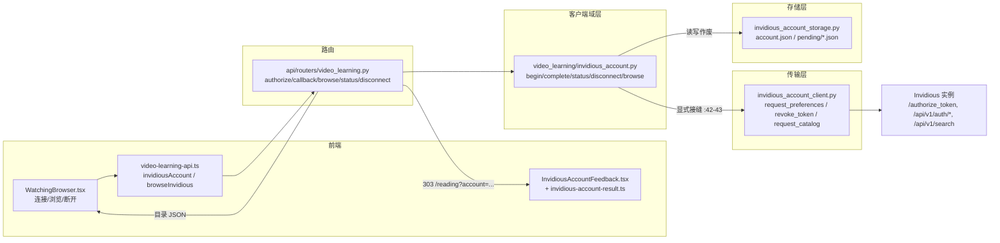

# Invidious 账号域代码导读（guide-invidious-accounts-2026-10-11）

- 基线：`origin/main @ 6cf793bd8`（v1.6.14）。
- 范围：Invidious 账号连接的存储 / 客户端 / 传输三层契约、授权回调与凭据边界、与 Watching 播放链路的接点。观看 UX 与测试轴不在本篇（见文末"去重边界"）。
- 行号锚均为该基线下的 `path:line`，相对仓库根目录。文中不出现任何真实实例地址或凭据。

## 0. 全景：一个账号域，两种数据通道

账号域解决"把学习者的 Invidious 订阅/播放列表接进来"，核心事实有两条：

1. **播放链路不消费账号凭据**。视频解析（元数据/字幕/MP4 流）走实例级匿名 API；账号 token 只用于目录浏览（feed/playlists）。这是全篇最重要的边界。
2. **token 是 Invidious 的签名 JSON**（session/scopes/signature/expire），全程只落盘在 owner 私有 secrets 树，不进数据库、不进日志、不进 URL。

## 1. 存储层：owner 私有文件契约（`invidious_account_storage.py`）

该模块只管文件系统，不认识 HTTP（模块头 :1-6 明确声明）。布局：

| 路径 | 内容 | 写入方 |
| --- | --- | --- |
| `<owner-secrets>/private/video-learning-invidious/account.json` | 已连接账号：version/api_base_url/scopes/connected_at/token | `write_account` :158 |
| 同上 `pending/<sha256(state)>.json` | 待完成授权流 `PendingFlow` :26（owner_id/api_base_url/callback_url/expires_at） | `replace_pending_flow` :118 |

关键契约：

- **目录 0700、文件 0600**：`asset_dir` :33 逐级建目录并 `chmod S_IRWXU`；`write_private_json` :69 用 `O_CREAT|O_EXCL` + `S_IRUSR|S_IWUSR` 创建临时文件，写满 fsync 后 `os.replace` 原子发布。
- **state 不做路径段**：`flow_path` :53 存 SHA-256 摘要——既避免路径穿越，也防止能列目录名的备份/快照泄露仍存活的一次性回调 state。
- **一次性领取靠同文件系统 rename**：`consume_pending_flow` :134 把源文件 rename 成 `.claim` 再读后删除。这跨 Uvicorn worker、跨重启生效（进程内字典做不到）。
- **同实例只保留一个流**：`replace_pending_flow` :118 写入前清掉同 owner 同 `api_base_url` 的旧流；`purge_expired` :110 在 begin/complete 时顺带清扫过期流（TTL 见 `FLOW_TIMEOUT_S`）。
- 读取一律 `read_json` :61：坏文件静默返 `{}`，由上层按"未连接"处理，坏盘不炸请求。

## 2. 客户端域层：授权工作流（`invidious_account.py`）

模块头 :1-7 即设计声明：只做 token 授权，不碰密码与浏览器 cookie。

### 2.1 发起（`begin_invidious_account_authorization` :70）

1. 要求已配置 `invidious.api_base_url`（来自 `load_video_learning_settings`，其合法性由 `service.py:_validate_origin` :105 把关：纯 HTTP(S) 源、无 userinfo、公网实例强制 HTTPS）。
2. 校验回调 URL：scheme 白名单、必须有 host、禁 userinfo/fragment、端口可解析（:76-88）。
3. `state = secrets.token_urlsafe(32)`（:91），追加到回调 URL query。
4. 授权页地址用 `public_base_url`（对外域）拼 `/authorize_token`，scopes 固定为 `ACCOUNT_SCOPES` :31-37（preferences 读、token 注销、feed/播放列表读——全部只读 + 撤销）。
5. 落一条 pending 流后返回授权页 URL。

`invidious_redirect_uri` :66 用 `_configured_public_url` :46 拼回调地址：取 `DEEPTUTOR_PUBLIC_URL` 环境变量并过一遍与 provider 相同的 origin 规范化；未配置时本地默认 `http://localhost:3782`。注释 :59-63 说明为何不信任请求头里的 Host/X-Forwarded-*。

### 2.2 完成（`complete_invidious_account_authorization` :169）

固定次序：领流（一次性）→ 解析 token → 验 token → 写账号。任何一步失败，流已被消费，回调不可重放。

- `_parse_token` :109：≤8 KiB（:38）；Invidious 会把 JSON form-encode 后再进 query，FastAPI 已剥外层，代码按"字面 JSON 不动、否则至多 `unquote_plus` 一层"处理（:113-121）；必须含非空 session/signature 与字符串 scopes 数组；`expire` 若存在须为正整数。
- `_scopes_include_required` :148：返回 scopes 必须是 `ACCOUNT_SCOPES` 的超集，缺一个即拒绝。
- 验证手段是 `request_preferences` 真调一次 `/api/v1/auth/preferences`（:178）——能读偏好即 token 可用。
- `write_account` :180 落盘的记录里保存发起时的 `api_base_url`，供状态检查比对。

### 2.3 状态与断开

- `invidious_account_status` :193 依次判：token 结构/过期（`_stored_token_is_usable` :154）→ scopes 漂移 → **实例地址漂移**（存量 `api_base_url` ≠ 当前配置即 `needs_reauthorization`，:203）→ connected。
- `disconnect_invidious_account` :215 的顺序是"先撤销上游、再删本地"：撤销遇传输错误时**保留**本地账号以便重试（:223-232），避免上游留下无本地凭据对应的孤儿 token。

### 2.4 目录浏览（`browse_invidious` :250）

- `search` 不需要账号（匿名 `/api/v1/search`）；`feed`/`playlists`/`playlist` 要求已连接，带 token 走 `/api/v1/auth/*`。
- 播放列表 id 白名单字符 + 长度上限（:273-279）。
- 输出侧 `_catalog_payload` :288 只放行卡片元数据：videoId 过 11 位字符白名单，缩略图默认回 `i.ytimg.com`，实例缩略图必须与 `public_base` 同源才采用（:300-312）。

### 2.5 失败码（`authorization_failure_code` :342）

把异常映射成稳定、不敏感的回调结果码（`authorization_cancelled/expired/scopes/token_invalid/token_rejected/unavailable/failed`），供前端查表翻译；provider 原始报错永不进 URL。

## 3. 传输层：HTTP 边界（`invidious_account_client.py`）

全部出口流量集中在三个函数，便于替身与审计：

| 函数 | 端点 | 超时 | 失败语义 |
| --- | --- | --- | --- |
| `request_preferences` :21 | GET `/api/v1/auth/preferences` | 15s | 网络→`TimedMediaError`；非 200→带状态码的固定文案 |
| `revoke_token` :43 | POST `/api/v1/auth/tokens/unregister` | 15s | 网络→`InvidiousTransportError`（触发 2.3 的"保留本地"）；非 2xx→`TimedMediaError` |
| `request_catalog` :67 | GET `/api/v1/(search\|auth/...)` | 20s | 401/403→"请重新连接"；其余→统一重试文案 |

- `bearer_token` :17：token JSON 紧凑序列化后放 `Authorization: Bearer`——凭据只出现在请求头。
- 所有客户端 `follow_redirects=False`：重定向不吞 POST、不把 token 带去别处。
- 域层通过 `_request_preferences`/`_revoke_token` 两个显式接缝（`invidious_account.py:42-43`）引用传输函数，测试可在不碰存储 mock 边界的情况下替传输打桩。

## 4. 授权回调与凭据边界

路由挂载在 `/api/video-learning`（`deeptutor/api/main.py:745`），五个端点（`deeptutor/api/routers/video_learning.py`）：

| 端点 | 行 | 行为 |
| --- | --- | --- |
| POST `/invidious/account/authorize` | :149 | 返回授权页 URL |
| GET `/invidious/account/callback` | :161 | 完成/失败→303 到 `/reading?account=<结果码>`，带 `Cache-Control: no-store` + `Referrer-Policy: no-referrer` |
| GET `/invidious/browse/{kind}` | :179 | 目录 JSON，`no-store` |
| GET `/invidious/account/status` | :199 | 连接状态 |
| POST `/invidious/account/disconnect` | :204 | 撤销并清除 |

凭据边界清单（读代码时的检查点）：

1. token 只存 `account.json`（0600）；owner 私有目录树由 `deeptutor/multi_user/paths.py:owner_secrets_dir` :217 划定，且不挂进沙箱容器（`paths.py:10-11`）。
2. 回调结果码不含 token、不含 provider 报错原文（`authorization_failure_code` :342 的 docstring 即契约）。
3. 登录过期撞上回调时，`main.py` 中间件 :474-482 把 401/403 改写成 `authorization_login_required` 重定向——防止把 provider 凭据滞留在回调 URL 里，认证本身照常执行。
4. 前端落点 `/reading?account=<码>` 由 `web/components/reading/library/InvidiousAccountFeedback.tsx:6` 消费，经 `web/lib/invidious-account-result.ts:2` 查静态文案表渲染——provider 输入永不经 React 渲染。

## 5. 与 Watching 播放链路的接点

前端接线（`web/components/watching/WatchingBrowser.tsx`）：

- 挂载即拉 `invidiousAccount('status')`（:61），未连接时 feed/playlists 视图不可用（:100 守卫）。
- `connect()` :140 调 authorize 后 `window.location.assign(authorize_url)`（:143）跳实例授权页；回调 303 落 `/reading`，由 InvidiousAccountFeedback 收尾。
- `select()` :173 → `onSelectUrl('https://www.youtube.com/watch?v=' + videoId)`（:323）：**目录里选中的视频转成标准 YouTube URL，进入通用的素材解析/收藏链路**，不携带任何账号状态。
- API 封装在 `web/lib/video-learning-api.ts`：`invidiousAccount` :422、`browseInvidious` :445，均 `no-store`。

后端接点（`deeptutor/video_learning/service.py`）：

- 播放解析 `_invidious_resolution` :547 经 `PROVIDER_RESOLVERS` :590 注册，走实例级匿名端点（metadata/captions/formatStreams），**签名里没有 token 参数**——账号域与播放域在数据上互不依赖。
- 实例地址合法性由 `_validate_origin` :105 / `normalize_video_learning_settings` :149 统一把关，账号域复用同一规则（`invidious_account.py:51-58`）。

一句话读法：账号域 = "浏览你在实例里的订阅和列表"；播放域 = "解析你点开的那个视频"。二者只在 WatchingBrowser 的"选中"动作处交汇，交汇产物是一个普通 URL。

## 6. 测试锚点与去重边界

- 后端：`tests/video_learning/test_invidious_account.py`（存储/传输/工作流契约，含 2.5 的接缝替身）。
- 前端：`web/tests/invidious-account-result.test.ts`、`web/tests/invidious-account-feedback.spec.tsx`、`web/tests/watching-browser.spec.tsx`、`web/tests/reading-add-invidious.spec.tsx`。
- 去重边界：观看交互与收藏 UX 见 guide-video-learning（观看轴）；存储与传输测试结论见 test-invidious-storage / FT35 卡与 AGEN-806（client 测试轴）。本篇只做账号域导读，不重复其结论。
