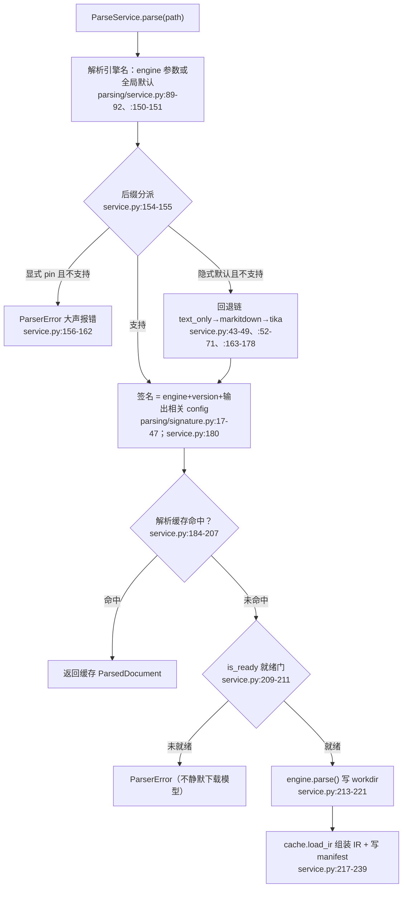

# 文档解析引擎族导读（guide-parsing-engines-2026-10-11）

- 基线：`origin/main @ 6cf793bd8`（v1.6.14）。
- 范围：`deeptutor/services/parsing/` 解析引擎族——公共骨架（`engines/factory.py`、`engines/formats.py`、`engines/_versions.py`、`engines/_install.py`、`base.py`、`service.py`）与七个引擎（text_only / mineru / docling / markitdown / pymupdf4llm / liteparse / tika）各自的探测、安装回退与格式分派边界。
- 去重：MinerU 的索引生命周期（journal、checkpoint、reindex）见 guide-mineru-indexing，本文不覆盖；各引擎 formats/版本契约测试（`tests/services/parsing/`）只作验证面引用，不展开。
- 行号锚均为该基线下的 `path:line`，相对仓库根目录。缩写：`parsing/` = `deeptutor/services/parsing/`，`engines/` = `deeptutor/services/parsing/engines/`。

## 0. 全景：一次解析的完整路径



读代码前先记住两层探测的分工：`is_available()` 只回答"入口能不能加载"（factory 在实例化前调用），`is_ready()` 才回答"现在能不能跑"（模型在不在、云配没配）。两层在 MinerU/Tika/text_only 上会出现"恒 available 但未 ready"。

## 1. 公共骨架

### 1.1 协议：`parsing/base.py`

- `Parser` 是 runtime_checkable Protocol（base.py:30-81）：`resolve_config` → `supported_formats` → `signature` → `is_ready` → `parse`。解析刻意不挂在 RAGPipeline 协议上，是上游共享的可选阶段（base.py:2-8）。
- `supported_formats()` 返回小写带点后缀集；**空集是有语义的**：表示"引擎自己做内容级/运行时判定"（base.py:48-55），不是"什么都不支持"。
- `parse()` 的 workdir 契约：总是写 `<stem>.md`，可加 `<stem>_content_list.json` 和 `images/`；`ParseService` 用 `cache.load_ir` 从 workdir 组装 IR（base.py:65-81）。
- `ReadinessReport` 三态 reason：`ready` / `models_missing` / `cli_missing` / `not_configured`（base.py:19-27），UI 依此引导出口（装包/下模型/改配置/换引擎）。

### 1.2 注册表：`engines/factory.py`

- 引擎 id 常量在 `runtime_settings.py:137-143`，默认引擎是 `text_only`（runtime_settings.py:163）。
- `_ENGINE_LOADERS`（factory.py:70-78）把 7 个 id 映射到零参懒加载函数（factory.py:27-66）：导入 registry 本身永不触发引擎依赖导入，缺可选包也不报错（factory.py:1-7）。
- `get_parser(name)`（factory.py:153-158）：先 `_normalize_name`（小写、`-`/空格→`_`，factory.py:149-150），未知引擎抛 `ParserError`。
- `is_engine_available`（factory.py:161-168）调用 `cls.is_available()`，**任何异常一律按 False**——探测绝不把路由决策变成导入期崩溃。
- `list_engines()`（factory.py:171-184）给设置页用的静态 `_ENGINE_META`（factory.py:83-146）+ available 布尔，全程不导入引擎依赖。

### 1.3 上传超集：`engines/formats.py`

- `known_parser_formats()`（formats.py:13-26）是六个引擎 formats 的并集——**不含 text_only**（text_only 的后缀集来自 chat/KB 共用的 `FileTypeRouter`，见 §2.1）。
- 定位是"上传/发现的超集路由提示"（formats.py:14-18，消费点 `services/rag/file_routing.py:345-347`）：文件能不能进 KB 看超集，能不能被解析由**所选引擎**在 `ParseService` 里终审。别把超集当成某引擎的能力清单。

### 1.4 版本协商：`engines/_versions.py`

- `package_version()`（_versions.py:15-20）：`importlib.metadata.version` + `lru_cache`。用发行版元数据而不是 CLI `--version` 子进程，保证签名计算便宜，同时引擎升级会换签名、作废解析缓存（_versions.py:1-6）。
- `version_at_least()`（_versions.py:23-35）：不导入 packaging 的纯数字 release 元组比较，短版本右侧补零对齐。
- 各引擎的版本下限常量：mineru `3.4.5`（engines/mineru/formats.py:9）、docling `2.123.1`（engines/docling/formats.py:18）、markitdown `0.1.7`（engines/markitdown/formats.py:11）、pymupdf4llm `1.28.2`（engines/pymupdf4llm/formats.py:7）、liteparse `2.14.2`（engines/liteparse/formats.py:7）、tika `4.0.0`（engines/tika/formats.py:15）。低于下限不算 `not_configured` 而是 `update_required`，引导"升级"而非"安装"。

### 1.5 一键安装：`engines/_install.py`

- `ENGINE_PIP_SPECS`（_install.py:39-53）与 pyproject 的 `[parse-*]` extras 同源（pyproject.toml:210-228）：pymupdf4llm / markitdown[all] / docling[xbrl]+docling-slim[format-iwork,format-opendocument,format-video] / liteparse。**mineru 和 text_only 不在表里**：前者是外部 CLI 或云 API（装法特殊，§2.2），后者内置无依赖（_install.py:36-38）。
- 模型下载 allow-list `ENGINE_MODEL_DOWNLOADERS` 只有 docling（`docling-tools models download`，_install.py:57-59）；MinerU 的"下载模型"按钮走**另一套**管理器（`mineru/models.py:107`、`:217`，路由 `api/routers/settings.py:1557-1603`），不在 _install.py 里。
- `BackgroundJobManager`（_install.py:116-269）：全局单例（_install.py:272-276）、**同一时刻只允许一个后台作业**（_install.py:190-195）；游标式行日志（`status(cursor)`，_install.py:152-162）、0.2s 节流 + 2000 行环形缓冲（_install.py:61-64、:233-269）、cancel=terminate（_install.py:164-177）。
- `start_install` 固定 `pip install --upgrade`（_install.py:137-147）：已装引擎也会被刷新到最新，以跟进新格式。argv 全部来自固定 allow-list，无注入面（_install.py:11-14、:197）。
- 安装成功回调 `_invalidate_import_caches`（_install.py:100-113）：`importlib.invalidate_caches()` + 清 `package_version` 缓存 + 清 markitdown formats 缓存，让同一进程内 available/签名立即翻转，无需重启。docling 的 formats 发现是纯静态表、无缓存可清，也**故意不导入** docling 运行时（macOS PyTorch/FAISS 的 OMP Error #15，见 §2.3）。
- `resolve_model_downloader`（_install.py:77-97）：先在服务器 python 同环境找 console script，再退回 PATH；兼容 Windows 的 `.exe` + PATHEXT。

### 1.6 分派与回退：`parsing/service.py`

- 后缀匹配 `_matches_supported_format`（service.py:28-31）：大小写不敏感的前缀 endswith，天然支持 `.tar.gz`/`.dclg.xml` 这类复合后缀。
- 全局默认引擎来自设置（service.py:89-92）；`supports()` 只是廉价路由检查，不初始化模型（service.py:94-102）。
- **回退链只在"隐式选择"时生效**：`_FALLBACK_ENGINE_PREFERENCE = ("text_only", "markitdown", "tika")`（service.py:43-49）。调用方显式 `engine=` pin 时，不支持就大声抛错、绝不静默换引擎（service.py:156-162）；隐式路径才走 `_find_fallback_engine`（service.py:163-178）。设计动机：混合 KB（MinerU 的 PDF + .txt 笔记）不能让整批 ingest 硬失败（#1502）。
- 回退候选必须已安装：`get_parser` 抛错即跳过（service.py:52-71 的 try/except）；**tika 的空后缀集匹配一切**（service.py:69 的 `not supported or ...`），所以 tika 是事实上的兜底——但接住后仍要在 readiness/远端解析阶段接受考验。
- 就绪门在缓存未命中后才检查（service.py:209-211）；产出空内容也算失败（service.py:218-221），失败清理 workdir（service.py:240-242）。

## 2. 七引擎决策表

| 引擎 | 探测（is_available → is_ready） | 安装 / 回退路径 | 格式分派边界 |
| --- | --- | --- | --- |
| text_only | available 恒 True（engines/text_only/engine.py:23-25）；ready 恒 True（:36-37） | 内置，无安装项；是隐式回退链的第一顺位（service.py:49） | `SUPPORTED_DOC_EXTENSIONS` = Office(PDF/docx/xlsx/pptx/epub) ∪ 文本族，来源 `utils/document_extractor.py:62-66`（复用 KB 路由的 `FileTypeRouter`，file_routing.py:55-65）；解析在隔离子进程跑 `extract_document_to_markdown`，受 `MAX_FILE_SIZE` 限制（engine.py:54-62） |
| mineru | available 恒 True（engines/mineru/engine.py:26-31）；ready 分模式：云要有 api_keys（engines/mineru/readiness.py:81-91）；本地要先过 CLI 探针（readiness.py:94-105；探针 backend.py:134-158，配置路径优先、PATH 找 `mineru`/`magic-pdf`），再过模型门（readiness.py:107-118，模型探测 fail-closed 扫 HF/ModelScope 缓存，readiness.py:19-76） | 无 pip 一键项；本地装法 `pip install -U 'mineru[all]>=3.4.5'`（提示语 readiness.py:101、backend.py:41-44）；"下载模型"是独立按钮走 mineru 专属管理器（models.py:107、:217；settings.py:1557）；运行期逃生口：切云/切 markitdown/text_only | `.pdf` + 8 种图片 + `.docx/.pptx/.xlsx`（mineru/formats.py:14-30）；遗留 `magic-pdf` CLI 只收 PDF（backend.py:214-224）；云模式 >200 页被钳制（config.py:22-26、:80-84）并自动切片（cloud.py:102、:193-197、:265-274） |
| docling | available = `find_spec("docling")`（engines/docling/engine.py:82-84）；ready 顺序：remote 只查 URL（:104-111）→ 本地查已装（:112-117）→ 版本 ≥2.123.1（:118-128）→ 模型在位或显式允许下载（:129-139；模型探测查 `DOCLING_ARTIFACTS_PATH`、`~/.cache/docling/models`、HF hub 的 docling/ds4sd 目录，:28-75） | pip 一键：docling[xbrl] + docling-slim[format-iwork,format-opendocument,format-video] ≥2.123.1（_install.py:48-51）；模型一键：`docling-tools models download`（_install.py:57-59、:77-97）；逃生口：切 text-only / markitdown（:131-138） | 静态表钉在 2.123.1 floor（docling/formats.py:23-100），**故意不导入 docling 运行时做格式发现**（macOS OMP Error #15，formats.py:1-10、:103-109）；remote 模式不经本地包/模型（engine.py:104-111），签名带 server URL（engine.py:92-100）；本地转换在隔离子进程（engine.py:166-168，local_worker.py:27） |
| markitdown | available = `find_spec("markitdown")`（engines/markitdown/engine.py:29-30）；ready = 已装且 ≥0.1.7（:45-63） | pip 一键 `markitdown[all]>=0.1.7`（_install.py:43），与 pyproject extra 同源；无模型；是隐式回退链第二顺位（service.py:49） | 静态 0.1.7 内置集 ∪ **运行时扫描已装 converters 的 `*EXTENSION*` 常量**（lru_cache，markitdown/formats.py:61-84；静态底座 :16-47）——未来 markitdown 新增格式无需等 DeepTutor 发版；Azure Content Understanding 云格式刻意排除（:13-15） |
| pymupdf4llm | available = `find_spec("pymupdf4llm")`（engines/pymupdf4llm/engine.py:43-45）；ready = 已装且 ≥1.28.2（:64-82） | pip 一键 `pymupdf4llm>=1.28.2`（_install.py:40）；无模型；不参与回退链 | 静态 1.28.2 表（pymupdf4llm/formats.py:12-43）：PDF/XPS/电子书/SVG/图片/文本，**Office 系要付费 PyMuPDF Pro，不宣传**（:9-11）；用当前 `pymupdf4llm.to_markdown` 而非遗留 helper（engine.py:124-134）；图片提取进 workdir/images 并重写为可移植 `images/<name>` 链接（:99-120、:136-155） |
| liteparse | available = `find_spec("liteparse")`（engines/liteparse/engine.py:46-48）；ready = 已装且 ≥2.14.2（:68-86） | pip 一键 `liteparse>=2.14.2`（_install.py:52）；无模型；不参与回退链 | 官方多格式表（liteparse/formats.py:11-41）；**Office/iWork/OpenDocument 依赖宿主机 LibreOffice**（:9-10）——包在、ready 为真也可能在解析期失败；`output_format`/图片目录被钉死为契约值不可配（engine.py:103-113 的 docstring、liteparse/config.py:17-21）；`ocr_failure_fatal=False`，OCR 失败降级不弃稿（engine.py:109-112） |
| tika | available 恒 True（engines/tika/engine.py:22-24）；ready = server_url 已配置（:40-47）；"Test" 按钮 ping `/version` 并校验 ≥4.0.0（:49-53，remote.py:70-89） | 无本地包/模型可装；远端服务器自备；是隐式回退链第三顺位（service.py:49） | **`supported_formats()` 返回空集**（engine.py:29-33）＝"交给远端做内容级判定"（base.py:50-55），对 ParseService 而言匹配一切；本地 `TIKA_4_0_0_KNOWN_FORMATS` 只是上传/路由提示、非硬 allow-list（tika/formats.py:1-19）；解析 = `PUT /tika`（octet-stream）拿 Markdown 写 `<stem>.md`（remote.py:34-67），415/422/429 有专门映射（:117-127） |

### 2.1 text_only：零依赖的基准面

- 探测两层都是常量 True（engine.py:23-25、:36-37），因此它永远可作为回退起点；但"解析成功"另说——隔离子进程失败仍抛 `ParserError`（engine.py:63-66）。
- 格式集与 chat 附件、KB 文本族**同一来源**（document_extractor.py:62-66 注释明确"加一处全联动"），所以 text_only 对纯文本类文件是无损兜底（service.py:46-48 注释）。
- 签名恒 `("text_only", "builtin-v1", {})`（engine.py:33-34）：没有任何输出影响型配置。

### 2.2 mineru：探测最深、状态最多的引擎

- 适配器本身极薄（engine.py 全文 87 行），复杂度全在 `readiness/backend/local/cloud/models` 五个模块。`is_available` 恒 True 是因为"没有硬 Python 导入"——真正的门在 `mineru_readiness`（readiness.py:79-118）。
- 模型探测 fail-closed 是有意设计：**确认不了模型在位就当缺失**，宁可让用户多点一次"下载"，也不允许 CLI 静默拉几个 GB（readiness.py:1-10）。识别规则：OpenDataLab 命名空间下 `mineru`/`pdf-extract-kit` 前缀，兼容 HF `models--` 与 ModelScope 两种缓存布局（readiness.py:19-31）。
- CLI 探针无子进程、便宜到可挂在每次 settings GET 上；`--version` 的重校验只在显式 Test 按钮后面（backend.py:134-158、:161-185）。探针顺序与实际执行顺序一致（backend.py:30-32），保证报错里说的命令就是将要跑的命令。
- 本地失败原因一码一话（backend.py:37-69），只有 `CLI_MISSING` 带安装提示——运行期失败不得误报成"没安装"（#1612，backend.py:34-36）。
- 云模式签名用 `cloud:<api_base_url>`、本地用 `package_version("mineru")`（engine.py:42）：切模式必然换缓存签名，旧产物不复用。

### 2.3 docling：静态格式表的理由

- formats.py:1-10 是全仓库少见的"性能/稳定性注释"：导入 docling 的 format-model 就会加载 Transformers+PyTorch，macOS 上与 FAISS 撞 OpenMP 直接 `OMP Error #15` 杀死后端进程。所以格式表静态钉在 floor 版本 2.123.1，升级 floor 时必须同步更新表（formats.py:9）。
- 模型目录探测顺序：`DOCLING_ARTIFACTS_PATH` → `~/.cache/docling/models`（`DOCLING_CACHE_DIR` 可覆盖，engine.py:39-47）→ HF hub 目录名含 `docling`/`ds4sd`（engine.py:28-29、:59-75），同样 fail-closed。
- 本地转换必须走子进程 worker（local_worker.py:27），把重依赖挡在 API/FAISS 进程之外；remote 模式（Docling Serve）则完全绕开本地包与模型（engine.py:104-111、:158-162）。

### 2.4 markitdown 与 liteparse：两派"跟随上游"策略

- markitdown 用**运行时反射**跟随上游：扫描已装 converters 模块的 extension 常量并 lru_cache（markitdown/formats.py:61-84），上游加格式即时生效；代价是发现逻辑依赖 markitdown 内部结构，异常时静默退回静态底座（:82-83 的 bare except）。
- liteparse 用**静态表 + 版本 floor**：表来自官方 README 的多格式支持清单（liteparse/formats.py:9-10），floor 2.14.2 保证表不过期。Office 族把"宿主机有没有 LibreOffice"外包给用户环境，ready 探测不检查它——这是该引擎"ready 但解析失败"的唯一常见来源。
- 两者都执行 workdir 契约：只写 `<stem>.md`；liteparse 额外把 `output_format` 钉成 markdown、图片目录钉成 `workdir/images`（config.py:17-21 说明这是引擎契约而非用户选项）。

### 2.5 tika 与 pymupdf4llm：两个极端

- tika 是唯一"空格式集"引擎：分派语义从"后缀白名单"切换为"远端说了算"。这带来两个副作用：上传超集里它的 200+ 后缀只是提示（tika/formats.py:1-7）；回退链里它匹配一切文件（service.py:69），成为隐式路径的最后兜底。
- pymupdf4llm 是唯一"无云、无模型、但保留图片资产"的轻引擎：签名含 write_images/image_format/image_dpi 三个输出影响型旋钮（engine.py:53-62）；空 images 目录会被删掉以免缓存层报出空 asset_dir（engine.py:115-120）。

## 3. 三处最易误读点

1. **`supported_formats()` 空集 ≠ 不支持**。空集的协议语义是"引擎自己做内容级判定"（base.py:50-55），`service.py:69` 和 `:102` 的 `not supported or ...` 会把空集当"匹配一切"。Tika 依赖这一点（engine.py:29-33）。把空集当"引擎坏了/没有格式"是读这段代码最常见的误读。
2. **回退链的生效条件比想象的窄**。`_FALLBACK_ENGINE_PREFERENCE`（service.py:49）只在**隐式选择的全局默认引擎**不认识后缀时启用；`engine=` 显式 pin 直接抛错（service.py:156-162）。回退候选仅 text_only/markitdown/tika 三个、且必须已安装（service.py:52-71）；mineru/docling/pymupdf4llm/liteparse 永远不会作为回退目标。另注意：回退解决的是"路由"，不解决"就绪"——回退后的引擎仍要过 readiness 门（service.py:209-211）。
3. **`is_available` 与 `is_ready` 是两层不同的门**。UI 引擎列表的 `available` 列来自 `is_available`（factory.py:171-184），对 mineru/tika/text_only 恒 True——它只说明"适配器能加载"；能不能真正解析由 `is_ready` 决定（模型在不在、云配没配、版本达不达标）。看到"设置页显示 available 但解析报 not ready"不是 bug，是设计（no silent download：readiness.py:1-10）。

## 4. 校验命令

```bash
# 行为面验证（限时 900s；覆盖 factory/formats/签名/service 分派与回退）
timeout 900 python -m pytest -q -p no:cacheprovider \
  tests/services/parsing/test_engines.py \
  tests/services/parsing/test_parse_service.py \
  tests/services/parsing/test_signature.py

# macOS 无 GNU timeout 时的等价限时写法（本文基线实际执行命令）：
perl -e 'alarm 900; exec @ARGV' .venv/bin/python -m pytest -q -p no:cacheprovider \
  tests/services/parsing/test_engines.py \
  tests/services/parsing/test_parse_service.py \
  tests/services/parsing/test_signature.py
# 本次结果：69 passed, 2 skipped in 1.18s
```

行号锚核对示例（基线 6cf793bd8）：`sed -n '43,49p' deeptutor/services/parsing/service.py` 应显示 `_FALLBACK_ENGINE_PREFERENCE`；`sed -n '29,33p' deeptutor/services/parsing/engines/tika/engine.py` 应显示空 frozenset 返回。
