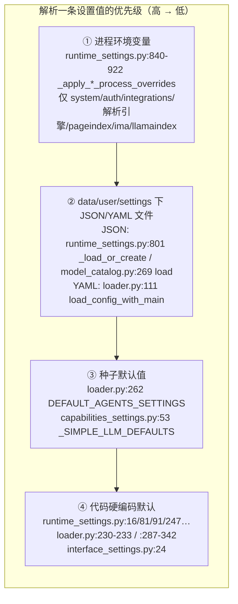
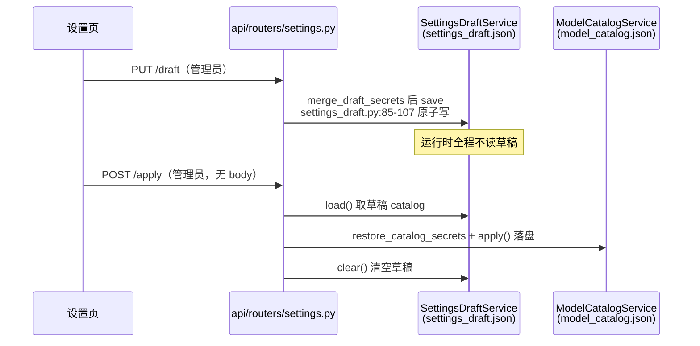

# 设置体系导读（services/config 与 services/settings 读写面）

- 基线：origin/main @ `6cf793bd8`（v1.6.14）。
- 范围：`deeptutor/services/config/`（loader / runtime_settings / model_catalog / settings_draft / settings_spec / provider_runtime / provider_links / origins / readiness 等）与 `deeptutor/services/settings/`（interface / starter / registry_edit / provider_edit / provider_probe / service_preview），以及 draft→apply 的 API 落点。
- 所有锚点形如 `path:line`，相对仓库根，均为该基线下的行号。
- 交付物：加载/覆盖优先级图（§2）、readiness 判定表（§5）、失败回退清单（§6）。

## 0. 全景：两套机制，一张目录

DeepTutor 的"设置"是两套机制并存在同一个目录里，读代码前先分清：

| 机制 | 载体 | 读者 | 覆盖方式 |
| --- | --- | --- | --- |
| A. YAML 静态配置 | `data/user/settings/agents.yaml`、`main.yaml` | `services/config/loader.py` | 用户文件 → 种子默认值 → 硬编码全局默认 |
| B. JSON 运行时设置 | 同目录下 `system.json`、`auth.json`、`integrations.json`、`document_parsing.json`、`model_catalog.json`、`interface.json`、`starters.json`、`pageindex.json`、`ima.json`、`llamaindex.json`、`graphrag.json`、`lightrag.json`、`lightrag_server.json` 等 | `services/config/runtime_settings.py`、`model_catalog.py`、`services/settings/*` | 代码默认值 → JSON 文件 → 进程环境变量（仅部分文件） |

目录由 `get_runtime_settings_dir()` 统一解析为 `data/user/settings`（`deeptutor/services/config/loader.py:23`）；YAML 侧每次读取后都会注入运行时路径（`loader.py:59` `_inject_runtime_paths`），YAML 里的 `paths.*` 不是用户可编辑状态。项目根 `.env` 被有意忽略，进程环境变量是唯一的部署覆盖面（`deeptutor/services/config/runtime_settings.py:466-469` 的类文档）。

分工铁律写在 `loader.py:306-309`：**agents.yaml 拥有全部 LLM 预算**（temperature、分阶段 max_tokens），**main.yaml 拥有运行时行为**（迭代上限、超时、重试、模式）；"main.yaml 里出现预算"按 bug 处理。

## 1. 配置面盘点：文件 ↔ 默认值 ↔ 归属模块

| 文件 | 默认值常量 | 归属模块 | 作用域 |
| --- | --- | --- | --- |
| `system.json` | `DEFAULT_SYSTEM_SETTINGS` `deeptutor/services/config/runtime_settings.py:16`（附件上限的夹取区间 `:74-79`） | `RuntimeSettingsService` | 全局（管理员） |
| `auth.json` | `DEFAULT_AUTH_SETTINGS` `runtime_settings.py:81` | 同上 | 全局 |
| `integrations.json` | `DEFAULT_INTEGRATIONS_SETTINGS` `runtime_settings.py:91` | 同上 | 全局 |
| `document_parsing.json`（旧名 `mineru.json`） | `DEFAULT_DOCUMENT_PARSING_SETTINGS` `runtime_settings.py:247`，七引擎切片 `:169-241`，新装默认 `text_only` `:163` | 同上 | 全局 |
| `pageindex.json` / `ima.json` / `llamaindex.json` / `graphrag.json` / `lightrag.json` / `lightrag_server.json` | `:275` / `:286` / `:321` / `:347` / `:361` / `:378` | 同上 | 全局 |
| `model_catalog.json` | `_default_catalog()` `deeptutor/services/config/model_catalog.py:243`；服务集 `SERVICE_NAMES` `:151`、可连接服务 `:165`、LLM 形服务 `:190`、模型能力键 `:194` | `ModelCatalogService` | 管理员目录，非管理员读也被重定向到管理员文件（`get_model_catalog_service` `model_catalog.py:648-658`） |
| `settings_draft.json` | `_empty_draft()` 信封 `deeptutor/services/config/settings_draft.py:43`（`version/updated_at/catalog/extensions`，`DRAFT_VERSION` `:40`） | `SettingsDraftService` | **每个用户一份**（`get_settings_draft_service` `settings_draft.py:162-168`），且运行时任何解析路径都不读它 |
| `interface.json` | `DEFAULT_UI_SETTINGS` `deeptutor/services/settings/interface_settings.py:24` | `services/settings/interface_settings.py` | **每个用户一份**（每次调用重新解析路径，`:74-78`） |
| `starters.json` | `DEFAULT_STARTER_SETTINGS` / `DEFAULT_TRACE_COUNT=20`、区间 `(3,100)` `deeptutor/services/settings/starter_settings.py:26-32` | `services/settings/starter_settings.py` | 每用户 |
| `agents.yaml` | 硬编码全局默认 `loader.py:230-233` + 每模块种子 `services.setup.init.DEFAULT_AGENTS_SETTINGS`（`loader.py:262` 惰性导入） | `get_agent_params` `loader.py:202`、`get_capability_params` `loader.py:345` | 全局 |
| `main.yaml` | 无代码默认表；缺失键由调用方的模块级常量兜底 | `load_config_with_main` `loader.py:111` | 全局 |
| `kb_config.json`（KB 根目录） | `_default_payload()` `deeptutor/services/config/knowledge_base_config.py:19` | `KnowledgeBaseConfigService` | 全局（管理员）；导入期冻结的 `DEFAULT_CONFIG_PATH` `:17` 仅作遗留回退 |

`origins.py`（`normalize_origin` `deeptutor/services/config/origins.py:21`、`normalize_origins` `:47`）不是文件而是归一化器：把 `host:port`、分号/逗号/换行分隔的粘贴值规范成浏览器 Origin 形态后写入 `system.json` 的 `cors_origins`（`runtime_settings.py:425-427` 调用）。

## 2. 加载顺序与覆盖优先级图

要点：

1. **环境变量只在 `RuntimeSettingsService` 家族生效**，且是"读取时覆盖、从不落盘"：`load_system(include_process_overrides=True)`（`runtime_settings.py:509-517`）先归一化文件内容再叠环境值（`:840-881`）。auth（`:883-900`）、integrations/turn 协调（`:902-922`）、MinerU/Docling/Tika（`:924-944` / `:1193-1201` / `:1209-1213`）、PageIndex（`:946-950`）、IMA（`:958-964`）、LlamaIndex（`:973-982`）同理。`model_catalog.json` 与 `interface.json` 没有环境覆盖。
2. **两条豁免**让文件最终能赢回控制权：
   - `DEEPTUTOR_IGNORE_PROCESS_ENV_OVERRIDES`（`runtime_settings.py:384`，判定 `:837-838`）整体关闭环境覆盖，服务只读设置卷的部署靠它；
   - `DEEPTUTOR_SETTINGS_DERIVED_ENV_KEYS`（`:392`，判定 `:783-799`）：父进程由设置文件渲染出的环境变量对子进程自报家门，子进程据此把"自家导出"视为空（`:786-790`），否则切换设置写文件后活进程仍答旧值（#1536，注释 `:386-391`）。操作员亲手设置的变量不在清单上，环境仍是权威（`settings_derived_keys` `:773-781`）。
3. **导出方向**：`render_environment`（`:704-753`）把非模型设置渲染成子进程环境名；`export_environment`（`:755-771`）真正写 `os.environ` 时，遇到操作员已有的外部值会登记进 `_external_process_keys` 而不覆盖（`:760-766`，`overwrite=True` 时仍写但保持外部标记）。
4. **agents.yaml 的三级回退**：全局默认（`loader.py:230-233`）→ 每模块种子（`:258-274`）→ 用户文件值（`:276-284`）。分阶段能力参数走另一张表：`_STAGED_CAPABILITY_DEFAULTS`（`:337-342`）与用户 `capabilities.<name>` 深合并（`:345-373`），**用户文件里的未知键被丢弃**（`:371-372`），拼写错误不会把值走私进不存在的阶段。
5. **search max_results 的专属链**：catalog 活动 profile 的 `max_results` → `main.yaml` 的 `tools.web_search.max_results` → `tools.web.search.max_results` → 默认 5，全程夹取 1–10（`deeptutor/services/config/provider_runtime.py:1398-1430`）。
6. **活动 profile/model 的自动回填**：catalog 归一化时，若 `active_profile_id` 不在可选集则落到第一个可选 profile（`model_catalog.py:569-577`）；`active_model_id` 不在活动 profile 的模型集则落第一个模型（`:578-591`）。`get_active_profile` 读取时再兜底一次（`model_catalog.py:598-622`），并把 `provider_ref`/`service_overrides` 解析成自包含 profile（`resolve_profile_provider` `deeptutor/services/config/provider_links.py:120`；凭据字段从 `provider_source` `:28` 按身份引用复制）。
7. **launch 期**：`LaunchSettings`（`deeptutor/services/config/launch_settings.py:15`）在启动器一侧读取 `system.json`/`interface.json` 决定端口与语言，来源记在 `source` 字段；启动引导统一走 `ensure_runtime_settings_files()`（`runtime_settings.py:1373-1384`，内部 `ensure_defaults` `:692-702` + catalog `load()`）。

## 3. draft→apply 流

"Save Draft"与"Apply"是两个不同的写：

- **信封结构**：`catalog`（整本模型目录）+ `extensions`（按页注册名的每页不透明 payload）+ `version/updated_at`（`settings_draft.py:43-44`）。payload 故意不建服务端 schema——能产出它的页面是唯一理解它的代码（模块头注释 `:11-23`）。
- **读路径隔离**：`GET /draft` 的注释（`deeptutor/api/routers/settings.py:1869-1877`）把承诺说死：草稿对其他一切读取路径不可见，这就是"存草稿"和"应用"的全部区别。`PUT /draft` `:1882-1899`、`DELETE /draft` `:1900-1903`、`POST /apply` `:1906-1936`（应用后 `draft_service.clear()` `:1932`，写在 `_runtime_catalog_write` 临界区内，`settings.py:481`）。
- **掩码密钥的两级解析**：`merge_draft_secrets`（`settings_draft.py:139-159`）把 `***` 占位符先对着草稿、再对活动 catalog 还原——顺序错了会把新输入的密钥每次重存时悄悄换回旧键（`:143-150` 注释）。API 侧每次 PUT/apply/test-provider 都走这条链（`settings.py:1888-1891`、`:1918-1926`、`:1947`）。
- **红action**：`redact_draft`（`settings_draft.py:124-136`）保证任何草稿回显都不带明文凭据；extension payload 只回传给所属账号（`:126-131`）。
- **presets 与 profile 只借道草稿**：预设在列举时返回无值描述、staging 时并入未应用草稿、绝不触碰活动设置（`deeptutor/services/config/settings_presets.py:1-9`；路由 `settings.py:1323-1353`）。设置 profile 导出/导入是纯审阅 diff、模块没有写路径（`deeptutor/services/config/settings_profile.py:1-6`）。
- **局部编辑器**：`merge_registry_edit`（`deeptutor/services/settings/registry_edit.py:67`）只改被寻址的实体、模型永不提交凭据；`merge_provider_edit`（`deeptutor/services/settings/provider_edit.py:9`）保留既有 ID 与扩展字段，掩码密钥先草稿后活动设置、共享凭据按 connection ID 更新（模块头 `:1-8`）。
- **探测后提交**（setup 能力侧）：`SettingSpec` 每行自带 `read/choices/write/probe`（`deeptutor/services/config/settings_spec.py:94-114`），scope/effect/probe 的契约见模块头 `:16-39`。探测跑在**候选 catalog**上（`_candidate_catalog` `:476-493`），单次尝试 25s 硬超时（`:503-504`，理由 `:496-502`），LLM 探测 `:520-564`、embedding 探测 `:567-617`，异常文本先脱敏再回传（`_redact` `:620-630`）。提交成功后清 LLM 配置缓存让改动当轮生效（`_clear_runtime_caches` `:461-473`）。

## 4. provider_runtime 解析面

- **LLM 匹配链** `_choose_resolved_provider`（`provider_runtime.py:785-832`），顺序固定：显式 binding →（binding 为 `openai` 且网关特征明显时让位网关检测 `:801-802`）→ 按 key/base 检测网关 → 按模型名匹配 → 本机地址（`11434` → ollama，其余 localhost → vllm，`:812-815`）→ 池里已配置的网关 → 池里本机/带 key 的 provider → 兜底 `openai`。活动 profile 缺 key/base 时从 provider 池映射补齐（`:913-925`），本机 provider 无 key 时填 `sk-no-key-required`（`:923-924`）。`task` 服务的 `reference`/`inherit` 模式折回 `llm` 解析（`:856-864`）；`reference` 无 selection 直接 `ValueError`（`:861`）。普通用户自有的 owner 绑定 profile 由 `_with_personal_llm_profiles` 合并进候选（`:703-718`）。
- **search 回退**：`resolve_search_runtime_config`（`:1510-1569`）——未知 provider → `unsupported`（`:1527-1538`）；`none` → 显式关闭（`:1540-1548`）；`soft_fallback` 的 provider 缺凭据 → 降级 `SEARCH_FALLBACK_PROVIDER = "duckduckgo"`（`:1550-1556`，常量 `:123`，spec 表 `:88-123`）；付费 provider（`soft_fallback=False`）缺凭据 → `missing_credentials`（`:1567`）。凭据查找按 provider 名而非活动位（`search_provider_credentials` `:1442-1465`），避免 Brave 的 key 被送到 Tavily。运行期失败转移链由 `search_fallback_candidates`（`:1480-1507`）给出：其他已配齐凭据的 profile → duckduckgo，`none` 与缺凭据者不入链。
- **语音/图像/视频**：`resolve_tts/stt/imagegen/videogen_runtime_config`（`:1227` / `:1281` / `:1317` / `:1358`）同构，本机 provider 同样填 `sk-no-key-required`（`:1299` / `:1340` / `:1381`）。
- **连通性测试**：`deeptutor/services/config/test_runner.py:15-21` 直接复用三个 `resolve_*`；草稿值的连通性测试先 `restore_catalog_secrets(saved, current)` 再测（`deeptutor/api/routers/settings.py:1947`、`:2210`、`:2235`）。

## 5. readiness 判定表

`build_settings_readiness()`（`deeptutor/services/config/readiness.py:883-1015`）产出值无关的判定矩阵：只暴露身份、布尔与稳定 reason code，URL/模型名/凭据/异常文本全部留在服务端（模块头 `:1-7`）；网络探测只限基础设施后端与远程解析器，**从不调用模型 provider**（`:6`）。

五个状态（`ReadinessState` `readiness.py:35-50`）：

| 状态 | 语义 |
| --- | --- |
| `enabled_verified` | 配置齐、在跑 |
| `available_disabled` | 可用但没开（一行开关的距离，`USABLE_STATES` `:56`） |
| `unavailable` | 中性缺席：没装包/没建依赖（不是故障） |
| `misconfigured` | 操作员**做了选择**但选择不工作 |
| `not_selected` | 从未配置（可选能力的默认态，不是故障） |

三个严重度（`SEVERITIES` `:53`）与评级函数 `row_severity`（`:780-793`）：**required 且不在 USABLE_STATES → blocker；misconfigured → warning；其余无通知**。整体 `ok` 等价于无 blocker/warning（`readiness_snapshot` `:796-821`，`:817`）。

各分区的判定规则：

| 分区 | required 判定 | 关键分支 | 锚点 |
| --- | --- | --- | --- |
| catalog 服务 | 仅 `llm`（`REQUIRED_CATALOG_SERVICES` `:133`）；**有 KB 时 embedding 才加入**（`:898-903`） | 未选 profile → `not_selected`；profile 丢失 → `misconfigured`；provider_ref 解析失败 → `required_credential_missing`；search 检查 provider≠none + `search_missing_credential` | `catalog_service_rows` `:227-411`（task reference 折叠 `:243-253`，provider_ref 失败 `:313-330`，search `:331-369`，模型检查 `:372-410`） |
| 文档解析器 | 仅被选中的那个（"上传走的就是它"，`:465-467`） | 选中但未安装 → `selected_parser_unavailable`；选中但引擎自报未就绪 → 引擎 reason；远程端点不可达 → `selected_parser_unreachable`；选中但注册表无此 id → `selected_parser_unknown` | `document_parser_rows` `:414-486`；探测循环与 2–3s 有界远程探测 `:906-946`、`:824-854`；探测异常 → `parser_probe_failed` `:934-938` |
| 知识库 | 否 | `status=ready` 且无需重索引且前置齐 → 绿；构建中 → `unavailable`；需重索引/前置缺失/其他 → `misconfigured` | `knowledge_base_rows` `:489-538`；前置检查（绑定状态 + 引擎预检）`:948-988` |
| 可视化器 | 否 | 装了+开了+运行时在 → 绿；没装/缺运行时 → `unavailable`（新装的常态，非故障 `:551-554`）；装了没开 → `available_disabled` | `visualizer_rows` `:541-580` |
| 聊天工具 | 否 | 依赖表 `_TOOL_DEPENDENCIES` `:191-197`：开着且依赖就绪 → 绿；开着且依赖坏 → `misconfigured`；开着但依赖从未配置 → `unavailable`（新装默认态，`:586-594`） | `tool_rows` `:583-633`；开关来源 `get_enabled_optional_tools` `deeptutor/services/settings/interface_settings.py:204-213`（叠加管理员授权） |
| 视频学习 | 否 | invidious 被选但未配 URL → `misconfigured`；未知 provider 追加一行 `selected_video_provider_unknown` | `video_learning_rows` `:636-692` |
| 运行协调 | 选中者 | memory + workers>1 → `multiple_workers_require_redis`；redis 被选未配 URL → `redis_url_missing`；配了但不通 → `redis_unreachable`（1.5s 探测 `:857-873`） | `coordination_rows` `:695-758`；建议级通知 `redis_available_but_memory_selected` `:760-772` |

`DETAIL_CODES`（`:64-122`）是全部稳定 code 的封闭集合，`tests/services/config/test_readiness.py` 用 AST 保持诚实（`:58-63`）。

## 6. 失败回退清单

| # | 场景 | 回退行为 | 锚点 |
| --- | --- | --- | --- |
| 1 | YAML 配置文件不存在 | `resolve_config_path` 抛 `FileNotFoundError`（不静默造默认） | `loader.py:104-108` |
| 2 | `agents.yaml` 缺失 | `get_agent_params` 抛 `FileNotFoundError`；未知 module 名返回全局默认 | `loader.py:251-253`、`:254-256` |
| 3 | `get_capability_params` 时 agents.yaml 缺失 | 不抛错，返回纯出厂分阶段默认表 | `loader.py:365-373` |
| 4 | JSON 设置文件损坏/为空/非 dict | 读成 `{}`，随后 `_load_or_create` 用默认值重建并落盘 | `runtime_settings.py:433-440`、`:801-817` |
| 5 | JSON 值类型/取值非法 | 归一化器逐键强制转换：非法枚举回默认（如解析引擎 `:1128-1132`、MinerU mode `:1145-1150`）、越界数值夹取（`:415-417`）、非法端口回默认（`:420-422`） | `runtime_settings.py` |
| 6 | 总附件上限小于单文件上限 | 归一化时抬到单文件上限（矛盾输入不拒绝而是修平） | `runtime_settings.py:1262-1263` |
| 7 | 旧 `mineru.json` 存在 | 就地改名为 `document_parsing.json`；新文件已存在则丢弃旧副本 | `runtime_settings.py:819-835` |
| 8 | v1 扁平解析配置 | 顶层旧键迁入 `engines.mineru`，活动引擎钉死 `mineru` 保行为 | `runtime_settings.py:1086-1130` |
| 9 | `lightrag.json` 非法结构/版本 | **不回退**：抛 `ValueError`（防止坏配置静默变回遗留模型回退） | `runtime_settings.py:658-673`、`:1046-1048` |
| 10 | `interface.json` 解析失败 | 读侧回默认值；写侧用空 map 替换坏文件（保留坏字节只会把用户困在坏设置里） | `interface_settings.py:179-184`、`:243-247` |
| 11 | `starters.json` 不可读 | debug 日志 + 默认值，`get_starter_settings` 永不抛 | `starter_settings.py:50-60` |
| 12 | `model_catalog.json` 损坏 | 读成空 → 整本默认 catalog 重建落盘 | `model_catalog.py:287-294`、`:282-285` |
| 13 | 草稿文件损坏 | 返回空草稿——"草稿不值得让设置页失败" | `settings_draft.py:71-76` |
| 14 | 草稿里的掩码密钥 | 先对草稿还原、再对活动 catalog 还原（顺序反了会丢新键） | `settings_draft.py:139-159` |
| 15 | profile 引用的 connection 已删除 | 解链不擦凭据，profile 用已持有的密钥继续工作 | `model_catalog.py:423-428` |
| 16 | LLM 活动缺 key/base | 从 provider 池按名映射补齐；本机 provider 无 key 填 `sk-no-key-required` | `provider_runtime.py:913-925` |
| 17 | task=reference 但无 selection | 抛 `ValueError`（`inherit` 则折回 llm） | `provider_runtime.py:856-864` |
| 18 | search 活动 provider 未知 / `none` / 软回退缺凭据 / 硬缺凭据 | unsupported / 显式关闭 / 降级 duckduckgo / `missing_credentials` 标记 | `provider_runtime.py:1527-1568` |
| 19 | search 运行期被限流/不可达 | 按 `search_fallback_candidates` 次序试其他已配置 provider → duckduckgo | `provider_runtime.py:1480-1507` |
| 20 | 环境变量与文件打架 | 文件默认赢回（#1536 derived-keys 豁免）；`DEEPTUTOR_IGNORE_PROCESS_ENV_OVERRIDES` 可整体关掉环境覆盖 | `runtime_settings.py:783-799`、`:384` |
| 21 | 操作员已有同名环境变量 | `export_environment` 登记为外部键，尊重不覆盖 | `runtime_settings.py:755-771` |
| 22 | 解析器探测抛异常 | 该引擎记 `parser_probe_failed`，不拖垮整张矩阵 | `readiness.py:934-938` |
| 23 | setup 提交前探测失败/超时 | 拒绝提交（25s 单次硬超时，错误文本脱敏后回传） | `settings_spec.py:496-564`、`:620-630` |
| 24 | 设置提交后进程内配置缓存 | `_clear_runtime_caches` 清 LLM 配置缓存，防"提示已切换、下轮仍跑旧值" | `settings_spec.py:461-473` |
| 25 | 大附件超过 WS 帧上限 | `compute_ws_max_size` 按总上限×4/3+8MB 推导且不低于 16MB 地板，需重启生效 | `runtime_settings.py:1417-1431`、`:59` 注释 |

## 7. 相关卡结论（只引用，不重复）

- **test-config-manager**：`utils/config_manager.ConfigManager` 的 YAML 合并语义与既有测试结论，见该卡；本文只在 §2 引用其在 `capabilities_settings.py` 的桥接角色（桥接契约见 `deeptutor/services/config/capabilities_settings.py:1-22` 模块头，双文件拆分表 `:43`，把 agents.yaml/main.yaml 拆合暴露给 `/api/capabilities/settings`）。
- **settings-services**：`services/settings/*` 各写入路径的并发与原子性测试结论见该卡；本文只记录行为事实（`interface_settings.py:216-263` 每文件一把锁 + temp-rename）。
- **readiness**：矩阵的逐行测试覆盖与 i18n 约束见 readiness 卡；本文只整理判定语义。
- **starter**：starters 建议面行为见 starter 卡；本文只登记 `starters.json` 的默认值与夹取。
- **docs-env-config-drift**：环境变量文档漂移的修复结论见该卡；本文 §2 的环境覆盖/derived-keys 语义与其结论互引，不另立说法。
