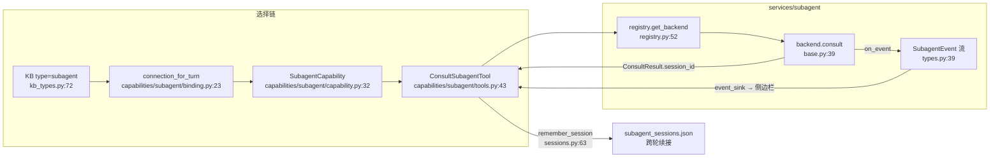

# 子代理家族代码导读（guide-subagent-family-2026-10-11）

- 基线：`origin/main @ 6cf793bd8`（v1.6.14）。
- 范围：`deeptutor/services/subagent/`（26 个文件，约 5.6k 行）——把用户本机/远端的智能体 CLI 作为子代理驱动的统一层：后端契约、11 个后端接入、凭据与会话差异、事件流归一；以及消费侧 `deeptutor/capabilities/subagent/` 的选择链。
- 定位（去重）：测试横切面见 `test-subagent-*` 系列卡与 `tests/services/test_subagent_backends.py`；Codex 系供应商凭据（OAuth 令牌生命周期）见 guide-codex-auth（`docs/guides/codex-auth.md`，独立分支）——本文只在"凭据继承"处引用，不复述。Partner（IM 伙伴）与 Partner Group 是注册在同一个 consult 通道上的另一族后端（services/subagent/partner.py:46、partner_group.py:14），本文不展开。
- 行号锚均为该基线下的 `path:line`；`services/subagent/`、`capabilities/subagent/` 省略 `deeptutor/` 前缀。

## 0. 全景：一条 consult 的生命周期

子代理不是一条独立管线，而是挂在 chat 循环上的一个"可咨询 KB"：用户把一个连接（`type=subagent` 的 KB，kb_types.py:72）选进知识库，本轮的 chat 模型就只靠 `consult_subagent` 这一个工具向它提问。端到端流转：

## 1. 模块地图

| 文件 | 行数 | 职责 |
| --- | --- | --- |
| services/subagent/base.py | 63 | 后端契约：`SubagentBackend.detect/consult`（base.py:22）与 `OnEvent` 回调（base.py:19） |
| services/subagent/types.py | 106 | 边界值类型：7 个事件通道（types.py:17-23）、`SubagentEvent`、`ConsultResult`、`DetectResult` |
| services/subagent/registry.py | 87 | 唯一知道"有哪些后端"的地方（registry.py:29-44）；`detect_all` 并行探测（registry.py:64） |
| services/subagent/config.py | 223 | `data/user/settings/subagent.json`：consult 预算 + 每后端权限/模型开关（config.py:37-83） |
| services/subagent/process.py | 214 | 共享子进程原语：无超时流式 `stream_process_lines`（process.py:62）、8s 探测 `probe_version`（process.py:156）、限长 `truncate_field`（process.py:188） |
| services/subagent/sessions.py | 83 | 跨轮会话注册表：`(chat session, connection) → backend session_id`（sessions.py:28、sessions.py:63） |
| services/subagent/models.py | 443 | /settings 的模型/effort 选项发现：每 kind 一个 provider（models.py:398-410） |
| services/subagent/claude_code.py | 364 | Claude Code：`claude -p --output-format stream-json`，token 级流 |
| services/subagent/codex.py | 320 | Codex：`codex exec --json`，item 级 JSONL |
| services/subagent/grok.py | 252 | Grok CLI：原生 `streaming-json`；`thought` 等私有载荷刻意不转发 |
| services/subagent/antigravity.py | 313 | Antigravity CLI（`agy`）：替代已退役的 Gemini CLI；`event` 字段判别 |
| services/subagent/kimi.py | 268 | Kimi CLI：`--print --output-format stream-json`，消息级；自造 session id |
| services/subagent/opencode_family.py | 508 | opencode 与其 fork MiMo-Code 共用一个驱动（serve + SSE） |
| services/subagent/opencode_server.py | 204 | 按 (CLI, workdir) 托管 `<cli> serve`：复用、回环口 + 随机密码、空闲回收 |
| services/subagent/hermes.py | 147 | Hermes Agent 本地：`chat --quiet` 一次性契约 |
| services/subagent/hermes_remote.py | 321 | Hermes 网关远端：`/v1/runs` + SSE，能力协商检测 |
| services/subagent/hermes_remote_client.py | 180 | Bearer 认证客户端（hermes_remote_client.py:46）与 SSE 读取 |
| services/subagent/hermes_remote_events.py | 125 | 网关生命周期事件 → 7 通道映射（hermes_remote_events.py:25） |
| services/subagent/openclaw.py | 197 | OpenClaw：`agent --session-key --json`，stdout 一份终态 JSON |
| services/subagent/deepseek_harness.py | 347 | DeepSeek Harness：Python SDK 优先、`dsh --profile headless` 兜底 |
| services/subagent/images.py | 101 | 把聊天附件物化成 CLI 可读的临时文件（images.py:32） |
| capabilities/subagent/binding.py | 106 | 本轮连接解析：伙伴组 > 伙伴 > subagent KB（binding.py:34） |
| capabilities/subagent/capability.py | 251 | 激活判定、系统提示、预算、注入 `_subagent` 服务端参数 |
| capabilities/subagent/tools.py | 254 | `consult_subagent` 工具：预算闸门、事件转发、会话持久化 |
| api/routers/subagents.py | — | 连接 CRUD、detect、模型选项、直发消息（subagents.py:58、:92、:117、:179） |

## 2. 统一契约：backend 只需回答两个问题

每个后端实现 `SubagentBackend`（base.py:22）：

- `detect()` — 本机/远端现在能不能用（`DetectResult`，types.py:75）。本地 CLI 用 8s 限时探测 `probe_version`（process.py:156），探测挂起即失败——与 consult 的"无限等"刻意相反。
- `consult(question, *, on_event, cwd, session_id, config, images, partner_id)` — 把一个问题交给代理，逐个 `await on_event(SubagentEvent)`（base.py:17-19 要求 await，保证慢消费者的背压生效），无条件等它自己跑完：**只有子代理自己的退出（干净或出错）结束 consult**（base.py:58-60；process.py:9-13）。唯一例外是远端的 idle_timeout（config.py:83，hermes_remote.py:210-221）。

边界类型刻意零依赖（types.py:3-7）：`SubagentEvent{kind, text, raw, meta}`、`ConsultResult{final_text, session_id, success, error, event_count}`。`raw` 保留 CLI 原始 JSON 不丢弃，`meta["merge_id"]` 把 start/finish 或流式增量折叠成侧边栏的一行动态行（types.py:46-50；工具侧再按轮次加前缀隔离，tools.py:145-152）。

**运行期服务端注入**：模型只提供 `question`；backend kind、cwd、预算、会话状态、每后端配置、图片全部由 `SubagentCapability.augment_kwargs` 注入 `_subagent`（capability.py:65-127，tools.py:78-85）。这是安全边界，也是"换后端不换工具"的原因。

## 3. 后端矩阵：接入 × 凭据 × 会话 × 事件流

| 后端 (kind) | 接入形态 | 凭据 | 会话续接 | 事件粒度 | 关键锚点 |
| --- | --- | --- | --- | --- | --- |
| `claude_code` | 本地 CLI：`claude -p … --output-format stream-json --verbose --include-partial-messages` | 继承 `~/.claude`，本层不碰令牌（claude_code.py:10-12） | CLI 输出带 `session_id` → `--resume`（claude_code.py:115-116）；逐事件捕获（claude_code.py:189-191） | token 级：`stream_event` 增量 + `assistant` 收口（claude_code.py:202-204、:252-289） | claude_code.py:66、:81、:128 |
| `codex` | 本地 CLI：`codex exec [resume <sid>] --json` | 继承 `~/.codex`（codex.py:14；OAuth 生命周期见 guide-codex-auth） | `thread.started`/事件字段拿 id → `exec resume`（codex.py:89-91、:300-305） | item 级：`*.updated` 增量流式 answer/reasoning（codex.py:63、:190-198） | codex.py:66、:81、:122 |
| `grok` | 本地 CLI：`grok --output-format streaming-json --single=…` | 继承 CLI 自身登录（grok.py:38-41） | `end.sessionId` → `--resume`（grok.py:237-241、:109-110） | token 级：`text` 增量，`usage` 事件切开新块（grok.py:194-210） | grok.py:53、:89、:116 |
| `antigravity` | 本地 CLI：`agy -p --output-format stream-json`（替代退役的 Gemini CLI） | 继承 CLI 登录 | 每个事件都带 `conversation_id`，见者有份 → `--conversation`（antigravity.py:253-258、:172-173） | step 级：`text_delta` 无聚合，按 step 自己累积（antigravity.py:291-297） | antigravity.py:127、:144、:181 |
| `kimi` | 本地 CLI：`kimi --print --output-format stream-json --session <uuid>`（两代 CLI 共用） | 继承 `~/.kimi`（kimi.py:23-24） | **自造 uuid**：`--session` 传不存在的 id 会按该 id 创建，从不解析输出（kimi.py:18-21、:134-141） | 消息级：CLI 已合并 delta，按 step 落地（kimi.py:3-9、:179-196） | kimi.py:75、:90、:122 |
| `opencode` / `mimo` | 本地 HTTP：托管 `<cli> serve` + SSE `/event` + 阻塞 `POST /session/{id}/message` | 继承 CLI 自身 `auth.json`（opencode_family.py:19-22）；serve 用随机密码环境变量（opencode_server.py:101-106） | `POST /session` 建、CLI 磁盘按 workdir 存活服务器重启（opencode_family.py:14-17、:196-203） | token 级：`message.part.delta` + `message.part.updated` 收口（opencode_family.py:264-285） | opencode_family.py:85、:374、:382；opencode_server.py:72 |
| `hermes` | 本地 CLI：`hermes chat --quiet --query`（stdout 只有最终答案） | 继承 CLI 自身 | stderr 尾行 `session_id:` → `--resume`（hermes.py:34、:113-118） | 仅最终：quiet 契约不暴露中间事件，不虚构（hermes.py:4-7） | hermes.py:37、:52、:85 |
| `hermes_remote` | 远端 HTTP：`POST /v1/runs` + SSE，`/v1/capabilities` 协商 | **唯一管凭据的后端**：环境变量名存配置（默认 `DEEPTUTOR_HERMES_REMOTE_API_KEY`，config.py:81），请求时读值、Bearer 头（hermes_remote.py:127-131、hermes_remote_client.py:46），输出全程脱敏（hermes_remote.py:302-318） | `session_id` 放请求体 + `X-Hermes-Session` 头；404 视为会话已失，可带历史重建（hermes_remote.py:177-196、:277-281） | token 级：`message.delta`（hermes_remote_events.py:48-58） | hermes_remote.py:44、:70、:110 |
| `openclaw` | 本地 CLI：`openclaw agent --session-key <sid> --json --timeout 0` | 继承 Gateway 自身 | **自造** `deeptutor-<hex>` 作 `--session-key`（openclaw.py:93-94） | 仅最终：stdout 一份 JSON（openclaw.py:126-156） | openclaw.py:35、:50、:81 |
| `deepseek_harness` | SDK 优先（线程内 `DeepSeekHarness`），缺包则 `dsh --profile headless` 兜底 | SDK/CLI 各自配置；`DSH_HOME` 定 home（deepseek_harness.py:253-255） | SDK：自造 `deeptutor-<hex>` 可续（deepseek_harness.py:177-178）；headless：一次一进程**不可续**（deepseek_harness.py:2-7、:104-105） | SDK token 级：`assistant/chunk` delta（deepseek_harness.py:272-290）；headless 仅最终 + stderr 推理启发（deepseek_harness.py:133-149） | deepseek_harness.py:43、:69、:167 |
| `partner` / `partner_group` | 进程内，走伙伴通道而非 CLI | 各通道自有 | 伙伴会话键（partner 分支） | 见 partner.py / partner_group.py（本文不展开） | partner.py:46；partner_group.py:14 |

模型/effort 选项面：每 kind 一个 provider（models.py:398-410）。Claude Code 无模型目录 CLI，靠 `/model` 抓取缓存 + 别名兜底 + 允许自由文本（models.py:156-179）；Codex 读 `$CODEX_HOME/models_cache.json` 与 `config.toml` 默认模型（models.py:182-224）；opencode 家族解析 `<cli> models`（models.py:286-314）；Antigravity/Kimi/Grok/Hermes/OpenClaw/DeepSeek 走自由文本 + 精选 effort 集（models.py:52-86、:234-283、:344-394）。

## 4. 权限与审批：headless 决不能等输入

consult 无超时（process.py:9-13），所以"代理停下来等批准"等于把本轮挂死。每个后端都有自己的非阻塞拼写，全部由 `BackendConfig` 字段驱动（config.py:37-83）：

- Claude Code：默认 `permission_mode=bypassPermissions`（config.py:54）→ `--permission-mode`（claude_code.py:117-118）。
- Grok CLI：`default_backend_config` 单独给 `dontAsk`（config.py:137-139）→ `--permission-mode`（grok.py:96-97）。
- Codex：`sandbox=workspace-write` + `approval=never` 经 `-c sandbox_mode=… / approval_policy=…` 下发（codex.py:97-108）；`bypass` 族映射到显式 `--dangerously-bypass-approvals-and-sandbox`（codex.py:50-52、:99-100）。
- Kimi / Hermes：`auto_approve` → `--yolo`（kimi.py:111-114、hermes.py:71-72）；Kimi `--print` 本就隐含 `--afk`。
- opencode 家族：`permission.asked` 总线事件由后端程序化应答，`auto_approve` 开则 `once`、关则 `reject`（opencode_family.py:287-291、:350-371）。
- hermes_remote：`approval.request` → `/v1/runs/{id}/approval`，同样按 `auto_approve` 二选一（hermes_remote_events.py:77-91）。
- Antigravity 特例：headless `agy` 对需批准的工具**软拒绝**而不是阻塞，所以只有显式放开的两个模式才传 `--dangerously-skip-permissions`，`default/plan` 保留软拒绝是安全的（antigravity.py:24-28、:71-75、:170-171）。

新增后端时这是最容易踩死的坑：任何"等交互输入"的路径都必须有等价的非阻塞拼写或显式失败。

## 5. 后端选择与降级链

**选择**是连接级的，不是运行时仲裁：用户连了哪个（KB `agent_kind`，binding.py:63-79），本轮就 consult 哪个；伙伴组/伙伴直选优先于 KB 选择（binding.py:35-61）。工具侧按 kind 取后端：`partner_group → PartnerGroupBackend`、`partner → PartnerBackend`、其余查注册表（tools.py:107-120）。平台**没有**跨后端自动 failover——一个后端不可用，detect 面板显示不可用（registry.py:64-84 并行探测、单点异常隔离成不可用结果），由人决定换连接。

**降级**都是后端内部（带内）的，读代码时按这五处找：

1. DeepSeek：SDK 可导入就走 SDK（可续会话、token 流），否则退 `dsh --profile headless`（一次一进程、不可续、答案从 stdout 累积）——dispatch 在 deepseek_harness.py:79-92。
2. opencode 家族：serve 进程死亡在下次 acquire 时被清掉并透明重生（opencode_server.py:91-96）；POST 响应缺 parts 时退回总线累积文本作为 final_text（opencode_family.py:183-190）。
3. hermes_remote：续接的 session 404 → 丢弃旧 id、按新会话重建（可选把历史随 `conversation_history` 带回，hermes_remote.py:177-196）。
4. Claude Code：没有 `result` 事件时退回 assistant 文本兜底 final_text（claude_code.py:177-178）。
5. 协议漂移防御：Codex schema 在演进，未知 item 渲染成 log 行而不是丢弃（codex.py:9-12、:296-297）；Antigravity 空流按已知上游 bug（antigravity-cli#76）命名失败而不是沉默（antigravity.py:84-87、:232-240）；Grok 畸形帧直接判失败、不回显疑似私有载荷（grok.py:158-165）；Kimi 退出码 75 标记可重试的供应商瞬断（kimi.py:61、:152-156）。

失败向上冒泡的出口是统一的：`ConsultResult.success=False` → 工具把 `[The agent returned no answer: …]` 作为失败工具结果还给 chat 模型（tools.py:208-215），模型自行决定换问法或放弃——这是提示层的选择，不是平台层切换。

## 6. 事件流归一

所有后端的原生事件都映射到 7 个通道之一（types.py:17-23）：`text / reasoning / tool / tool_result / log / result / error`。三条横向约定：

- **粒度差被 merge_id 吸收**：token 级后端（claude_code、opencode 家族、grok、hermes_remote、deepseek SDK）与"先占位后补全"的 item（codex web_search、opencode/grok tool 行、antigravity tool）都把同一逻辑行标成稳定 `merge_id`，前端保留最新即得打字机效果；工具层再拼上轮次号防多轮串号（tools.py:145-152）。逐后端锚点：claude_code.py:299-303、codex.py:58-63、opencode_family.py:284、grok.py:208、hermes_remote_events.py:57、kimi 消息级不需要、deepseek deepseek_harness.py:288。
- **限长与降噪一致**：字段统一 4000 字符截断（process.py:185-193）；遥测类事件直接丢弃（claude_code.py:50）；未知类型给 `log` 兜底而不是静默（claude_code.py:249-250、codex.py:222-223、grok.py:251-252、hermes_remote_events.py:112-115）。
- **隐私裁剪是各后端自留的**：Grok 的 `thought` 与 usage 签名不转发（grok.py:5-7、:189-193）；hermes_remote 对所有 text/raw 递归替换密钥为 `[REDACTED]`（hermes_remote.py:302-318），且**不把本地文件路径传给远端**——网关契约没有附件字段，图像直接拒绝（hermes_remote.py:170-172）。

图像转发按后端能力分五档，全部受 `forward_images` 每后端开关门控（config.py:76、capability.py:106-113；附件先物化到临时目录，跑完即删，tools.py:229-249、:180-184）：Codex 原生 `-i` 逐文件（codex.py:113-117）；Claude Code 无 `-p` 图像 flag，改为把路径写进 prompt 让其 Read 工具看 + `--add-dir` 放行目录（claude_code.py:89-114）；opencode 家族做成 base64 `file` part（opencode_family.py:436-447）；Hermes 只有一个 `--image` 位置，多余的列进 prompt（hermes.py:73-80）；Kimi / Grok / hermes_remote 明确不支持（kimi.py:24、grok.py:143-145、hermes_remote.py:170-172）。

## 7. 新增后端 checklist

1. 新建 `services/subagent/<kind>.py` 实现 `SubagentBackend`（base.py:22）：`kind/display_name/cli_command` + `detect()` + `consult()`。本地 CLI 保持 `local_cli=True` 默认；远端网关抄 hermes_remote 的 `local_cli=False, detectable=True`（hermes_remote.py:50-51）。
2. 注册进 `registry.py:29-44` 的 `_BACKENDS`——能力、API、UI 全部经此发现，不改别处。
3. 在 `models.py:398-410` 加选项 provider（模型/effort 建议或 free-text）；有可刷新目录（如 opencode 的 `models --refresh`、Claude 的 `/model` 抓取）就在 `sync_backend_options`（models.py:419-435）加分支。
4. 事件映射：每条原生事件落到 7 通道之一（types.py:17-23），未知类型给 `log` 兜底；同一逻辑行的 start/finish 或增量用稳定 `meta["merge_id"]`。
5. 审批路径必须有非阻塞拼写（见 §4），并以"headless 挂起 = 平台挂死"为审查标准；远端才允许 idle_timeout。
6. 会话续接：能从输出拿 id 就逐事件捕获，拿不到就自造（kimi.py:18-21 / openclaw.py:93-94 模式）；跨轮持久化由 tools.py:186-199 + sessions.py:63 统一处理，backend 只需回填 `ConsultResult.session_id`。
7. 图像：支持就接 `images` 参数（staging 已备好，tools.py:229），不支持就显式失败（grok.py:143-145 模式），不要静默丢弃。
8. 空流/空答案一律按失败报并点名原因（antigravity.py:232-240、deepseek_harness.py:161-164 模式）。
9. 测试落在 `tests/services/test_subagent_backends.py`（命令构造、事件映射、会话、settings 往返）与 `tests/api/test_subagents_router.py`（API 契约）；凭据相关断言不要复述令牌内容（与 guide-codex-auth 同一口径）。

## 8. 关联

- guide-codex-auth（`docs/guides/codex-auth.md`，独立分支）：`codex` 后端继承的 `~/.codex` 凭据的登录/刷新/存储细节。
- `test-subagent-*` 系列卡：命令构造与事件映射的回归面，即 `tests/services/test_subagent_backends.py` 各测试组。
- 事件如何继续流向侧边栏：`docs/guides/events-and-progress-chain.md`（链路 C）。
