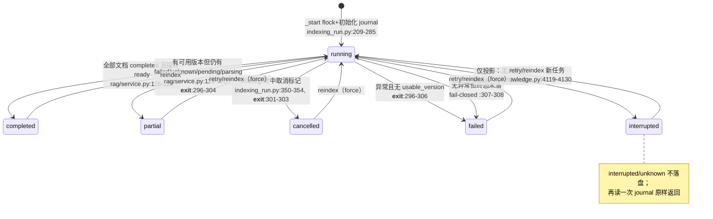

# 状态机：journal、checkpoint 与全部状态转换

基线 `origin/main @ 6cf793bd8`。所有锚点 `path:line` 相对仓库根目录。

## 1. 存储边界：三个文件

| 文件 | 角色 | 锚点 |
| --- | --- | --- |
| `<kb>/.indexing-run.json` | 索引 journal（权威恢复状态） | 读写 `indexing_run.py:86`、`:177`；写入一律走 `atomic_write_json`（`:430-431` → `file_io.py:72-92`：同目录 tmp + fsync + rename，不暴露半写文件） |
| `<kb>/.indexing-cancel.json` | 取消标记 | 写 `request_cancel` `indexing_run.py:440-447`；读合并进投影 `:100-109` |
| `<kb>/.indexing.lock` | 主人租约（flock） | 获取 `:211-225`；释放 `:315-326`；存活探测 `_lease_is_held` `:113-130` |

KB 目录由 `resolve_kb_dir`（`kb_paths.py:24-36`）解析：普通 KB 是
`data/knowledge_bases/<name>/`，linked KB 指向外部目录。

## 2. 两层状态

### 2.1 run 级 state

- 运行态只有 `running`（`indexing_run.py:243`），另有投影态 `interrupted`。
- 终态集合 `_TERMINAL = {completed, partial, failed, cancelled, interrupted}`
  （`:31`）。`interrupted` **只存在于投影里**（`:159`），活着的主人从不写它。

### 2.2 document 级 status

| status | 含义 | 写入点 |
| --- | --- | --- |
| `pending` | preflight 登记、待处理 | `indexing_run.py:273` |
| `excluded` | 格式不支持，预检即淘汰 | `indexing_run.py:272-273` |
| `failed` | 预检哈希失败（`:275`）或解析失败（`parsing/service.py:129`，带 `failure_code` + 脱敏 detail） |
| `parsing` | 解析中 | `parsing/service.py:111` |
| `parsed` | 解析完成；缓存命中时带 `parse_reused: true` | `parsing/service.py:123-125`、`:195` |
| `embedding` | 嵌入中 | `pipelines/llamaindex/document_loader.py:189` |
| `completed` | 已进入发布版本 | `pipelines/llamaindex/pipeline.py:491-494`；RAG 服务回调 `rag/service.py:96-100` |
| `unknown` | 主人死亡时在途，结果不可观测 | 投影 `indexing_run.py:148-156`；终局收尾 `:416-418` |

## 3. 转换总图

## 4. 转换细节（照基线路径逐条核对）

1. **进入 running**：`_start`（`indexing_run.py:209-292`）先以非阻塞 flock 抢
   `.indexing.lock`，抢不到抛 `IndexingBusyError`（`:226-230`）——同 KB 同时只允许一个
   索引 worker。随后读 `visible_run` 记下 `previous_task_id`（`:232`、`:249`），初始化
   journal：`state=running`、`phase=preflight`、PID/进程创建时间、`usable_version=None`
   （`:234-253`），再对源列表（rebuild 会并集 `raw/` 全量，`:258-263`）逐个哈希分类，
   写入 pending/excluded/failed（`:264-281`）。第一次 `_save`（`:285`）即首个 checkpoint。
2. **进度 checkpoint**：`phase()`（`:356-385`）与 `document()`（`:387-398`）每次更新都
   整体落盘，因此 journal 永远停在过去某个"安全边界"上。`parsing/service.py:104-130`
   在每次解析输出行时刷新 `phase(parsing, activity=...)`（`:113-117`），解析前 `check()`
   （`:122`）是取消生效的安全边界。
3. **取消**：`request_cancel`（`:440-447`）要求 task_id 匹配且未终态，写取消标记；
   worker 侧 `check()`（`:344-354`）在下个边界抛 `IndexingCancelled`，`__exit__`
   归为 `cancelled`（`:301-303`）。异步启动期间被取消也有兜底（`:196-202`）。
   MinerU 子进程轮询 `run.check()` 实现进程级取消（`mineru/local.py:236-247`）。
4. **发布校验（usable_version 的唯一来源）**：管线发布前 `_publish_verified`
   （`pipeline.py:467-494`）依次：phase `verifying`（`:473`）→ 持久化索引探针
   `verify_persisted_index`（`:474`）→ 源文件重哈希 `run.verify_sources`
   （`:476`；实现 `indexing_run.py:400-407`，源变化即拒绝发布）→ 写 version meta
   （`:477-488`）→ 置 `run.data["usable_version"]`（`:490`）→ 逐文档 completed。
   RAG 服务层复核：`run.check()`（`rag/service.py:112-113`）→
   `latest_ready_provider_version` 探针（`rag/service.py:116`；实现
   `index_probe.py:96-103`），无 ready 版本直接抛"did not pass the provider readiness
   check"（`:117-118`）；按剩余文档是否含 failed/unknown/pending/parsing 决定
   `partial` 或 `completed`（`:119-122`）。
5. **退出收敛**：`__exit__`（`indexing_run.py:294-313`）带异常退出时按
   `usable_version` → `partial`、取消 → `cancelled`、否则 `failed`（`:296-306`）；
   **无异常但终态未落**（例如管道里漏调 finish）强制 `failed`，错误码为
   "Index readiness was not verified."（`:307-308`）——发布校验不可跳过。
6. **终局收尾**：`finish()`（`:409-428`）把仍在 `pending/parsing/embedding/parsed`
   的文档改写为 `unknown`（`:416-418`，终局时刻仍不可观测），记录
   `finished_at/usable_version/error_code/error`（`:419-427`）。错误码取自
   `failure_code` 分类器（`:62-82`：timeout / resource_exhaustion /
   dependency_missing / unsupported_input / model_download_failed /
   embedding_failed / invalid_output / runtime_failure），错误文本经 `_redact`
   （`:46-59`）抹掉 bearer/key/token 等凭据并截尾 1600 字符。
7. **崩溃投影（interrupted 的来源）**：`visible_run`（`:133-162`）对非终态 journal
   做 liveness 判定——psutil 核对 `pid` + `process_started_at`（`:139-143`，防止
   PID 复用冒充活人），无 psutil 时退化为 flock 探测（`:113-130`）；主人已死则
   返回投影：`state=interrupted`、在途文档（pending/parsing/embedding）→
   `unknown`（`:148-156`）、附 `recovery` 提示语（`:161`）。**投影是纯函数**：
   不写 journal、不重试、不建任务（测试 `test_restart_projection_is_read_only_and_retains_completed_sources`
   锁定该合同，`tests/knowledge/test_indexing_run.py:75`）。
8. **journal 损坏的保留语义**：`load_run`（`:85-110`）校验 `schema=1` 与
   `documents` 结构；读失败/结构非法抛 OSError "…original file preserved"
   （`:91-98`）——损坏现场原样保留，不自动重建、不覆盖。

## 5. 恢复语义一句话

重试复用两类已验证成果：**解析缓存**（内容寻址，`parsing/service.py:180-199`，
命中即 `parse_reused=true`）与**已完成切片**（journal 里的 `completed`）；
`unknown` 的未检查点阶段从头再来；发布校验保证只有通过探针与源哈希复核的
version-N 目录才会成为 `usable_version`。
