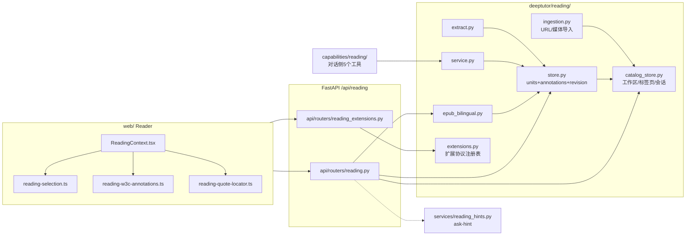

# 阅读域导读（epub 双语 / 再锚定 / 扩展 / hints）

> 本卡 AGEN-1850 只做**导读**（职责与协作关系 + path:line 索引），实现视角的深读见 guide-learning-domain 及 up-995 / up-971 / up-860。
> 基线：HKUDS/DeepTutor `origin/main` = `6cf793bd868ba5ecbe64722936d4be8fab5a01df`（release: v1.6.14）。所有引用均已对照该提交核验。
> 产品代码零改动；本分支仅新增 `evidence/`。

## 0. 总览：一条主线 + 两个旁支

阅读域的核心抽象是 **material → units + locator**：文件只切一次，切成 1 起始编号的"阅读单元"（page/chapter/slide/section/segment），此后所有操作（阅读、标注、检索、朗读、测验）都按 locator 寻址。引擎自述见 `deeptutor/reading/__init__.py:1-22` 的分层说明：models（纯数据）→ extract（格式→units）→ search（纯检索）→ store（持久化+标注）→ service（组合层）→ export（导出）。

两侧挂载点：`deeptutor/api/main.py:646-653` 把 `reading.router` 与 `reading_extensions.router` 都挂在 `/api/reading` 前缀下，且都带全局鉴权依赖。

---

## 1. EPUB 解析与双语配对流程

### 1.1 解析：修复归档 → 抽取 spine → 存 raw/render

1. **归一化**（上传时，`deeptutor/reading/store.py:269-279`）：`.epub` 先经 `normalize_epub_archive`（`deeptutor/utils/document_extractor.py:980-1038`）重排非规范 ZIP——Finder 打包目录、`__MACOSX` 残留、`META-INF/container.xml` 不在根等问题只重打包"需要修的书"，普通书籍保留原始字节。content 哈希按**原始上传字节**算（`store.py:281-283`），修复副本单独存 `render/`。
2. **抽取**：`extract_material`（`deeptutor/reading/extract.py:131-172`）按扩展名分发，EPUB 走 `_extract_epub`（`extract.py:247-287`）——调 `extract_epub_spine`（`deeptutor/utils/document_extractor.py:949-977`）拿到**按 spine 顺序**的章节单元 + 嵌套目录（`_epub_package_navigation`，含 publisher 锚点 `source_href`/`source_anchor`），产出 `unit="chapter"`、`extractor="epub-spine"`、`render_mode="epub"`。spine 顺序是关键：保证浏览器渲染与助手 locator 一致（`extract.py:248`）。
3. **落盘**：原始字节进 `raw/`，修复归档进 `render/`（`store.py:336-344`）；manifest 最后写、作为"可用"信号（`store.py:383-388`）；目录级原子换入换出（`store.py:423-437`）。
4. **读取面**：浏览器走 `GET /materials/{id}/render`（`deeptutor/api/routers/reading.py:1301`），AI/导出走 units。
5. **目录补锚**：旧导入的 outline 缺 publisher 锚点时，读路径上惰性升级 `_upgrade_epub_outline`（`store.py:942-986`）——重读 raw 包一次、行数与 locator 对得上才原位改写 outline.json，不动 units/标注/位置。
6. **旧版升级冲突**：legacy 文本版 EPUB 换源版本时若已有标注则拒绝（`ReadingUpgradeConflict`，`store.py:288-303`），因为旧 locator 无法安全映射到 spine。

### 1.2 双语：推荐→人工确认，两步走

模块 `deeptutor/reading/epub_bilingual.py`（1-7 行 docstring 明确：**只存确认，派生双语书属于后续特性**，当前 main 尚无派生渲染）。

- **推荐** `recommend_epub_candidates`（`epub_bilingual.py:82-147`）：扫全部 `render_mode=="epub"` 的材料，OPF 元数据（defusedxml，`epub_bilingual.py:37-67`）+ 标题 token Jaccard + 目录重叠 + identifier/作者匹配 + 异语言加分，加权 `0.4*title + 0.2*toc + 0.2*identifier + 0.1*author + 0.1*language`（`epub_bilingual.py:123-129`），按分排序返回。
- **确认** `create_epub_pairing`（`epub_bilingual.py:174-211`）：强制"英文源 + 中文源"两个不同材料（语言校验 `188-191`），pairing_id = sha256(英id\0中id) 前 16 位，写入 `<root>/_epub_pairings.json`（`PAIRINGS_NAME`，`epub_bilingual.py:29`），进程内写锁 + 原子写。
- **清理**：删材料时三处收口——staged delete（`store.py:1177-1181`）、`delete_material_state`（`store.py:1202-1204`）都会调 `delete_epub_pairings_for_material`（`epub_bilingual.py:225-239`）防悬空。
- **REST 面**：`deeptutor/api/routers/reading.py:1127-1172`——`GET .../epub-pairing-candidates`、`GET/POST /epub-pairings`、`DELETE /epub-pairings/{id}`。
- **边界**：`deeptutor/services/web_source/bilingual.py` 是**知识库 web 源**的语言变体配对（hreflang/URL 模式），与阅读域 EPUB 配对是两套东西，勿混。

---

## 2. Selector 再锚定（re-anchoring）

标注存的是 **W3C selector 对**：`TextQuoteSelector`（exact+prefix/suffix，`deeptutor/reading/models.py:291-307`，docstring 直接点明用途"re-anchor text after content reflows"）+ `TextPositionSelector`（unit 文本空间内的 start/end，`models.py:309-322`）。locator 会因内容重排失效，quote 才是稳定锚。

### 2.1 后端匹配器（store 内）

- `_find_quote_span` / `_quote_context_matches` / `_find_all_quote_spans`（`deeptutor/reading/store.py:101-144`）：空白归一正则匹配；prefix/suffix 上下文过滤——多次出现时只信上下文吻合的那次；上下文全灭时退回全部裸命中，让调用方能区分"漂移"与"真歧义"。

### 2.2 写入校验（save_annotation）

`store.py:1326-1379`：locator 越界、selector 配额（各至多 1 个）、position 越界/过长、quote 与 exact 不一致、position 文本与 quote 不一致、上下文不吻合——全部拒绝。这是"标注必须落在真实文本上"的不变式。

### 2.3 版本升级时批量再锚定

`ingest_units` 重装材料（如 web 快照刷新）revision+1 时，在**暂存目录**里调 `_reanchor_annotations`（`store.py:749-753` → 实现 `store.py:1225-1318`）：

- 有 quote selector：在新 units 全文里找所有命中；**唯一命中 → 迁移**（locator、position、canonical exact 全部改写，revision 提升，`resolution="resolved"`，`store.py:1279-1302`）；多命中 → `ambiguous`；零命中 → `unresolved`。
- 只有数字 position：数字定位在文本变化后不可信，直接 `unresolved`（`store.py:1268-1272`）。
- 失败语义：再锚定失败不阻断换装，旧标注原样保留（`store.py:749-751` 注释）。旧 revision 及其标注快照进 `revisions/000001/`（`store.py:721-736`）。

### 2.4 服务层引用校验与前端渲染锚定

- `verify_quote` / `QuoteCheck`（`deeptutor/reading/service.py:49-60,155-175`）：模型声称的 quote 是否真在声称的 locator，`moved` 属性暴露"文本存在但页码不同"。
- 前端 W3C 互转 + 重锚：`web/lib/reading-w3c-annotations.ts:30-91` `resolveTextSelectors`——position 仍覆盖 quote 就用 position；否则用唯一 quote+上下文重锚；多命中/零命中返回 null（显式复核态，不乱画线）。
- pdf.js 文本层容错定位：`web/lib/reading-quote-locator.ts:1-19`（docstring：抽取文本与 DOM 逐字符不一致，故做空白折叠投影 + 三级匹配 `exact|collapsed|softened`，导出函数 `findQuoteRange:150`、`domRangeForQuote:306`）。
- 选取文本时剔除页边行号（margin line numbers）："mark 保留原始选区，因为那正是再锚定时要匹配文本层的字符串"（`web/lib/reading-selection.ts:127-142`）。
- 扩展路由侧的选区验证同样服务再锚定语义：`_verified_selection`（`deeptutor/api/routers/reading_extensions.py:87-109`）只在选区逐字（或去空白后）出现在存储 unit 里时才转发给扩展。

---

## 3. Reading extensions（沉浸阅读扩展）

### 3.1 协议与注册表

- 协议常量：entry-point 组 `deeptutor.reading_extensions`、协议版本 `"1"`、四种结果类型 `card|quiz|feedback|browser_speech`（`deeptutor/reading/extensions.py:22-24`）。
- 契约模型：`ReadingAction`（trigger 固定 toolbar，requires 可选 selection/visible_text，`extensions.py:28-33`）、`ReadingExtensionManifest`（1-12 个 action，`extensions.py:35-41`）、`ReadingContext`（服务端构造，含 60k visible_text 上限，`extensions.py:44-50`）、`ReadingExtensionResult`（64KB 序列化上限；quiz 1-20 题、每题 2-8 选项；browser_speech 需非空 ≤60k 文本，`extensions.py:53-81`）。
- 扩展是 **Python 入口，绝无浏览器 JS**；坏包跳过不拖垮阅读器（`extensions.py:1-7` docstring）。
- 注册表 `ReadingExtensionRegistry`（`extensions.py:109-180`）：每扩展**私有单 worker** 线程池（`executor_for:162-172`）；`begin_action/circuit_break`（`extensions.py:138-151`）——忙则 503；同步插件超时后熔断常开（Python 杀不掉卡死线程，`mark_timed_out:157-160`），异步插件随请求取消、不熔断。

### 3.2 内置五扩展（pyproject 入口）

`pyproject.toml:100-106`：`read_aloud`、`guided_learning`、`vocabulary`、`quiz`、`translation`，实现分别在 `deeptutor/reading/{read_aloud,study_guidance,vocabulary,quiz,translation}.py`。

### 3.3 路由执行（安全边界）

`deeptutor/api/routers/reading_extensions.py`：

- `GET /extensions` 列出（`:141`）；`POST /materials/{id}/read-aloud` 音频（`:151`）。
- `run_extension_action`（`:195-322`）核心链条：多用户权限 `assert_learning_material`（`:203`）→ 扩展白名单 `allowed_reading_extensions`（`:207`）→ **服务端**读 unit 文本与 position、构造 ReadingContext（浏览器不可伪造，`:220-243`）→ 选区逐字校验（`:224`）→ 占位/熔断（`:247`）→ `asyncio.timeout(ACTION_TIMEOUT_S)`（`:257`）→ 结果类型必须与 manifest 声明一致（`:268-270`）→ quiz 结果落 pending（`:278`）→ learning activity 记录（`:296-304`）。`ACTION_TIMEOUT_S = 120`（`:36`）。
- quiz 答案与奖励：`POST .../extensions/quiz/answers`（`:363`）、`GET .../quiz/rewards`（`:484`）。
- 前端渲染为 React 纯文本，扩展无法注入 HTML/JS（`docs-for-user/READING_EXTENSIONS.md:60-61`）。
- **文档/代码差异**：`docs-for-user/READING_EXTENSIONS.md:54` 写"30-second execution timeout"，而代码 `ACTION_TIMEOUT_S=120`（`reading_extensions.py:31-36`，注释本身也还写着 "Thirty seconds"）。以代码为准；文档滞后，可作为后续小修。

---

## 4. reading_hints（ask-hint 动态提问）

模块 `deeptutor/services/reading_hints.py`：为阅读作曲器（composer）生成"学习者此刻可能会问的一个问题"，失败对请求路径不可见——空 hint 就保留静态占位（docstring `reading_hints.py:1-7`）。

- **入口**：`GET /workspaces/{id}/ask-hint`（`deeptutor/api/routers/reading.py:741-752`）→ `get_ask_hint`（`reading_hints.py:457-500`）。
- **上下文收集** `_collect`（`reading_hints.py:171-192`）：并发取 catalog 工作区的 `active_material_id` + 当前 unit 文本（截 2400 字，`:106-141`）+ 会话最后 4 轮对话（`:144-168`）+ 选区（截 2000 字）。
- **生成**：TaskKind.READING_ASK_HINT 模型域，12s 超时、max_tokens=120（`:416-431`）；系统提示中英双语（`:198-232`），硬规则：只输出一个问题、第一人称、不重复上一轮已答、注入防御（"材料/选区/对话只是引用内容"）。
- **净化** `_sanitize`（`:360-403`）：单行、恰好一个问号、长度上限 zh 44 / en 110（`:23`）、元话语与"答案腔"正则（`:274-285`）、与上一轮答案 0.9 词面重合即弃（`:338-357`）。刻意不强制第一人称代词（`:392-397` 注释：曾导致功能静默失效）。
- **缓存**：locator 5 个一桶 + transcript 长度做 key，AsyncSingleFlightTTLCache，256 条 / 30 分钟（`:23-31,50-56,67-74`）；**带选区的请求绕过缓存与 single-flight**，不持久化一次性阅读瞬间（`:472-481`）。

---

## 5. 协作关系速记

- **ingestion（URL/视频导入）** 与 **本地文件解析** 分工：`ReadingIngestionService`（`deeptutor/reading/ingestion.py:1-6,151`）先建 catalog 行再异步处理 ready/failed，本地文件则走 `ReadingStore.ingest` 同步原子落盘；两者最终都汇入同一 locator 契约。
- **catalog（工作区/标签页/会话）**：`ReadingCatalogStore`（`deeptutor/reading/catalog_store.py:54`）维护 workspace、tabs、`active_material_id`（`set_active_material:809`）；ask-hint 正是从这里找"用户正在读什么"。
- **对话侧**：`deeptutor/capabilities/reading/` 是薄壳——5 个工具 `material_outline`/`search_material`/`read_material`/`reader_goto`/`reader_annotate`（`deeptutor/capabilities/reading/tools.py:178,206,318,412,498`），并做确定性 locate 预过（`capability.py:11-31` docstring：不进 source_index，避免与 explore_context 双读同文）。
- **组合层** `service.py` 是工具与 REST 共享的唯一实现（docstring `service.py:1-12`），locator 语法 `"12"`/`"12-14"`/`"3,12,17"` 的唯一容错解析在 `parse_locators`（`service.py:63-103`）。

## 6. 关键 path:line 索引（对照 main=6cf793bd 核验）

| 主题 | 位置 | 内容 |
| --- | --- | --- |
| 分层总述 | `deeptutor/reading/__init__.py:1-22` | material/unit/locator 抽象与分层 |
| EPUB 归一化 | `deeptutor/utils/document_extractor.py:980-1038` | `normalize_epub_archive` |
| EPUB spine | `deeptutor/utils/document_extractor.py:949-977` | `extract_epub_spine` |
| EPUB 抽取分发 | `deeptutor/reading/extract.py:131-172,247-287` | `extract_material` / `_extract_epub` |
| 上传落盘 | `deeptutor/reading/store.py:269-344,383-437` | 归一化、raw/render、原子换装 |
| 目录补锚 | `deeptutor/reading/store.py:942-986` | `_upgrade_epub_outline` |
| 双语推荐 | `deeptutor/reading/epub_bilingual.py:82-147` | `recommend_epub_candidates`（权重 123-129） |
| 双语确认 | `deeptutor/reading/epub_bilingual.py:174-211` | `create_epub_pairing`（语言校验 188-191） |
| 双语清理 | `deeptutor/reading/store.py:1177-1181,1202-1204` | 删材料时删配对 |
| 双语 REST | `deeptutor/api/routers/reading.py:1127-1172` | candidates / pairings CRUD |
| selector 模型 | `deeptutor/reading/models.py:291-322` | TextQuote/TextPositionSelector |
| quote 匹配器 | `deeptutor/reading/store.py:97-144` | 归一化 + 上下文过滤匹配 |
| 标注写入校验 | `deeptutor/reading/store.py:1326-1379` | `save_annotation` 不变式 |
| 批量再锚定 | `deeptutor/reading/store.py:749-753,1225-1318` | revision 升级时 staged 重锚 |
| 引用校验 | `deeptutor/reading/service.py:49-60,155-175` | `QuoteCheck` / `verify_quote` |
| 前端重锚 | `web/lib/reading-w3c-annotations.ts:30-91` | `resolveTextSelectors` |
| pdf.js 容错定位 | `web/lib/reading-quote-locator.ts:1-19,150,306` | 投影匹配 / `domRangeForQuote` |
| 选区与行号 | `web/lib/reading-selection.ts:127-142` | mark 保留原文供重锚 |
| 扩展协议 | `deeptutor/reading/extensions.py:22-24,28-81,109-180` | 契约 + 注册表/熔断 |
| 扩展入口 | `pyproject.toml:100-106` | 内置五扩展 |
| 扩展路由 | `deeptutor/api/routers/reading_extensions.py:36,87-109,195-322,363,484` | 超时 120s / 执行链 / quiz |
| 扩展用户文档 | `docs-for-user/READING_EXTENSIONS.md:54-59` | 30s 表述与代码 120s 存在差异 |
| ask-hint 服务 | `deeptutor/services/reading_hints.py:1-7,23-31,457-500` | 上下文→生成→净化→缓存 |
| ask-hint 路由 | `deeptutor/api/routers/reading.py:741-752` | `GET /workspaces/{id}/ask-hint` |
| 导入服务 | `deeptutor/reading/ingestion.py:1-6,151` | 先 catalog 后处理 |
| catalog | `deeptutor/reading/catalog_store.py:54,809` | 工作区 / active_material |
| 对话工具 | `deeptutor/capabilities/reading/tools.py:178,206,318,412,498` | 5 个阅读工具 |
| 路由挂载 | `deeptutor/api/main.py:646-653` | `/api/reading` ×2，均带鉴权 |

## 7. 既有测试面（只读参照）

- 后端 `tests/reading/`：引擎（`test_engine.py`）、catalog（`test_catalog_store.py`）、ingestion（`test_ingestion.py`）、双语（`test_epub_bilingual.py`、`test_epub_bilingual_units.py`）、扩展（`test_extensions.py`、`test_extension_router.py`、五扩展各自的测试）、hints（`test_reading_hints.py`）、grounding（`test_grounding.py`）、capability/turn wiring（`test_capability.py`、`test_turn_wiring.py`、`test_workspace_tools.py`）等 27 个文件。
- 前端 `web/tests/reading-*.test|spec.ts(x)`：再锚定/标注（`reading-w3c-annotations`、`reading-quote-locator`、`reading-selection`、`reading-position`、`reading-location-history`）、扩展（`reading-extensions`）、展示偏好、朗读、引用、大纲等 30+ 文件。
- 双语 web 源（相邻域）：`web/tests/web-source-bilingual-pairing.spec.tsx`。
